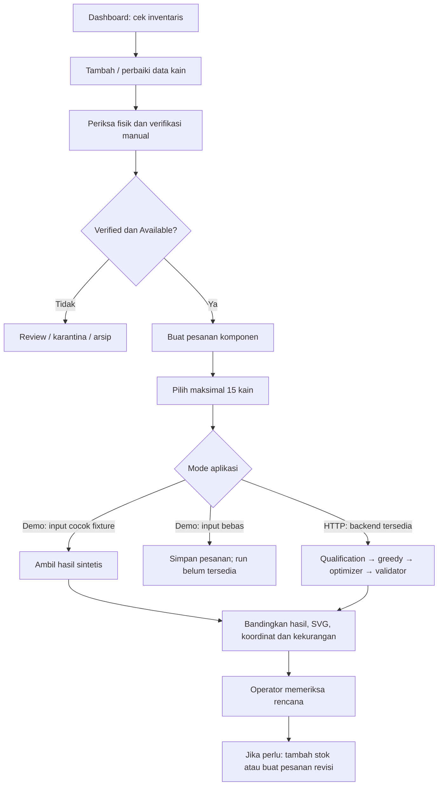
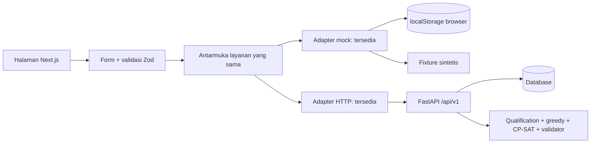

# Alur use case dan realisasi LoopCut AI

Dokumen ini memetakan tujuan pengguna, langkah penggunaan, respons aplikasi, dan realisasi teknis. Acuan: PRD produk, PRD frontend/backend, dan implementasi frontend saat ini.

## 1. Tujuan dan status aplikasi

LoopCut AI membantu operator konveksi mengubah catatan stok kain sisa menjadi kandidat pemanfaatan untuk pesanan baru. Hasil yang dituju adalah rencana pemotongan yang dapat diperiksa, bukan instruksi mesin atau transaksi konsumsi stok.

**Status saat ini:** frontend memakai HTTP secara default. Inventaris dan pesanan disimpan di backend SQLAlchemy/SQLite; rencana dihitung greedy dan CP-SAT, divalidasi, lalu disimpan sebagai snapshot. Database/solver nyata sudah lulus 76 pengujian. Adapter frontend dan renderer juga sudah diperiksa bersama API melalui test ASGI bridge. Mode mock opsional tetap menggunakan penyimpanan browser dan tujuh fixture sintetis, tanpa menjalankan solver.

Bagian use case di bawah menjelaskan alur bersama; uraian mode mock berlaku ketika `.env.demo.example` diaktifkan. Implementasi backend adalah jalur HTTP yang sekarang menjadi default. Pengujian browser tetap menunggu port preview tersedia.

**Pengguna:** satu operator dalam satu workspace. Peran gudang, admin produksi, dan pemilik dapat diperagakan oleh operator yang sama; aplikasi belum menyediakan akun atau pembagian hak akses.

## 2. Aturan bersama

- Satu record kain = satu lembar persegi panjang, dengan kode unik.
- Bahan dan warna harus cocok persis; `DENIM` tidak otomatis dianggap sama dengan `COTTON`.
- Dimensi integer `1–10000` mm; ukuran komponen sudah termasuk allowance yang dibutuhkan.
- Quantity per baris `1–30`; jumlah seluruh unit maksimal 30 per rencana.
- Maksimal 15 kain disertakan dalam satu run. Jumlah stok inventaris tidak dibatasi menjadi 15.
- Rotasi 90° hanya diizinkan jika pengguna mencentangnya pada komponen.
- Verifikasi data bukan pemeriksaan fisik oleh AI. Operator tetap memeriksa kondisi kain secara manual.
- Rencana tidak mengurangi stok, melakukan reservasi, memesan bahan, atau mengendalikan pemotongan.
- Luas reuse merupakan luas komponen teralokasi, bukan penghematan pembelian atau emisi yang terjamin.

## 3. Use case seluruh fitur

### UC-01 — Memantau workspace melalui dashboard

**Aktor / tujuan:** operator ingin mengetahui pekerjaan yang perlu dilakukan sebelum merencanakan produksi.

**Alur:**
1. Buka `/`.
2. Baca jumlah lembar tersedia, kain terverifikasi, kain perlu review, dan pesanan tersimpan.
3. Pilih Inventaris untuk memeriksa stok, Buat Pesanan untuk input baru, atau Mulai Demo untuk latihan.

**Respons:** angka mengikuti data yang tersimpan; workspace kosong tetap menawarkan tindakan berikutnya. Stok tersedia dapat mencakup kain yang belum terverifikasi. KPI kain terverifikasi menghitung seluruh status stok, sedangkan keterangan kandidat menunjukkan kain Verified + Available.

**Implementasi frontend / mode mock:** TanStack Query memanggil layanan inventaris/pesanan; adapter mock membaca localStorage. Loading dan error tampil jika data belum tersedia atau tidak bisa dibaca.

**Realisasi backend:** halaman memakai `GET /api/v1/remnants` dan `GET /api/v1/orders` melalui adapter HTTP.

**Berhasil bila:** KPI mengikuti perubahan inventaris/pesanan dan tidak menampilkan angka dampak yang dikarang.

### UC-02 — Menjalankan demo lengkap

**Aktor / tujuan:** pengguna baru atau presenter ingin memahami aplikasi dengan cepat.

**Alur:**
1. Klik Mulai Demo atau Muat Data Demo.
2. Pilih satu dari tujuh skenario.
3. Baca pemberitahuan penggantian data lokal.
4. Klik Ganti Data & Buka Skenario.
5. Ringkasan pesanan terpilih terbuka.
6. Klik Jalankan Rencana, lalu periksa hasil.

**Respons:** aplikasi memasukkan tujuh lembar stok contoh dan tujuh pesanan sintetis; pesanan sesuai skenario dibuka. Data workspace sebelumnya diganti hanya setelah konfirmasi.

**Implementasi frontend / mode mock:** seed ditulis ke localStorage, cache data diperbarui, dan pengguna diarahkan ke `/orders/o_demo_[skenario]`. Fitur tersedia hanya pada mode mock dengan flag demo aktif. Menjalankan plan mengambil fixture, tanpa menghitung solver.

**Realisasi backend:** CLI seed server tersedia melalui `python -m app.demo.seed`. Tombol seed lokal tidak otomatis menjadi seed backend.

**Berhasil bila:** alur seed → run → comparison → layout dapat diperagakan dalam dua menit, dengan label sintetis tetap terlihat.

### UC-03 — Mendaftarkan kain sisa

**Aktor / tujuan:** operator gudang ingin stok yang sebelumnya berupa catatan menjadi data terstruktur.

**Contoh:** kain `USER-001`, lot `LOT-A`, bahan `COTTON`, warna `BLACK`, ukuran `1200 × 800` mm.

**Alur:**
1. Buka `/remnants`, klik Tambah Kain.
2. Isi kode, material, warna, lebar dan tinggi; lot, kondisi, dan sumber informasi dapat ditambahkan.
3. Klik Simpan Kain.
4. Periksa baris baru pada tabel.

**Respons:** kain disimpan sebagai `NEEDS_REVIEW` + `AVAILABLE`; belum menjadi kandidat plan. Kode duplikat, kode material/warna tidak valid, serta dimensi pecahan/nol/negatif ditolak dengan pesan.

**Implementasi frontend / mode mock:** React Hook Form + Zod memvalidasi formulir; adapter mock memvalidasi ulang, membuat ID/timestamp, memeriksa kode unik, lalu menyimpan ke localStorage.

**Realisasi backend:** `POST /api/v1/remnants`; server mengulang validasi dan menyimpan ke database.

**Berhasil bila:** data terlihat setelah dialog ditutup dan tetap ada setelah refresh.

### UC-04 — Memverifikasi kain

**Aktor / tujuan:** operator ingin mengizinkan penggunaan kain yang data dan kondisinya sudah diperiksa.

**Alur:**
1. Cari kain berstatus Perlu Review.
2. Ukur dan periksa bahan, warna, serta kondisi secara manual di luar aplikasi.
3. Klik Verifikasi pada baris kain.
4. Konfirmasi pemeriksaan.

**Respons:** status menjadi `VERIFIED`. Kain masuk pool hanya jika status stoknya juga `AVAILABLE`. Verifikasi tidak memulihkan kain karantina/arsip secara otomatis.

**Implementasi frontend / mode mock:** tindakan memperbarui `verification_status` lewat adapter mock; tabel dan data kandidat diperbarui.

**Realisasi backend:** `PATCH /api/v1/remnants/{id}` dengan `verification_status=VERIFIED`; server menegakkan qualification gate.

**Berhasil bila:** Verified + Available dapat dipilih, sementara Needs Review tidak masuk pool otomatis.

### UC-05 — Memperbaiki data kain dan melakukan verifikasi ulang

**Aktor / tujuan:** operator menemukan ukuran atau spesifikasi yang salah.

**Alur:**
1. Klik Edit pada kain.
2. Ubah data yang salah, misalnya lebar `1200` menjadi `1199` mm.
3. Jika kain sebelumnya Verified, pilih apakah pemeriksaan ulang sudah dilakukan.
4. Simpan.

**Respons:** perubahan bahan, warna, dimensi, atau kondisi mereset status menjadi `NEEDS_REVIEW`, kecuali pengguna mengonfirmasi ulang secara eksplisit pada penyimpanan yang sama. Perubahan sumber informasi saja tidak mereset verifikasi.

**Implementasi frontend / mode mock:** adapter membandingkan field inti sebelum/sesudah. Checkbox pemeriksaan ulang mengirim `verification_status=VERIFIED` bersama perubahan.

**Realisasi backend:** PATCH dan aturan reset yang sama harus diterapkan server. Validasi frontend tidak menggantikan aturan server.

**Berhasil bila:** perubahan tanpa verifikasi ulang mengeluarkan kain dari kandidat baru, tetapi tidak mengubah snapshot plan lama.

### UC-06 — Mengarantina kain yang diragukan

**Aktor / tujuan:** operator ingin menahan kain dari perencanaan karena perlu pemeriksaan tambahan.

**Alur:** klik Karantina → baca dialog → konfirmasi.

**Respons:** `stock_status=QUARANTINED`; status verifikasi yang ada tetap tercatat, tetapi kain tidak masuk pool.

**Implementasi frontend / mode mock:** PATCH melalui adapter mock dan refresh data inventaris.

**Realisasi backend:** `PATCH /api/v1/remnants/{id}` dengan `stock_status=QUARANTINED`.

**Berhasil bila:** stok hilang dari kandidat tanpa menghapus record inventaris atau hasil historis.

### UC-07 — Mengarsipkan atau memulihkan kain

**Aktor / tujuan:** operator ingin mempertahankan catatan kain yang tidak lagi digunakan, atau mengaktifkannya kembali.

**Alur:**
- Arsip: klik Arsipkan → konfirmasi → status menjadi `ARCHIVED`.
- Pulihkan: pada kain karantina/arsip, klik Pulihkan → konfirmasi → status menjadi `AVAILABLE`.

**Respons:** record tetap ada. Pemulihan tidak memverifikasi kain secara otomatis; kain Needs Review tetap perlu pemeriksaan.

**Realisasi sekarang/backend:** perubahan status melalui PATCH; tidak ada DELETE fisik pada MVP.

**Berhasil bila:** filter status menampilkan record yang tepat dan hanya Verified + Available menjadi kandidat.

### UC-08 — Mencari dan menyaring inventaris

**Aktor / tujuan:** operator ingin menemukan stok tertentu tanpa memeriksa semua baris.

**Alur:** masukkan kode kain/lot → pilih filter material, warna, atau status → baca hasil → hapus filter jika diperlukan.

**Respons:** tabel menampilkan record yang memenuhi seluruh filter. Jika tidak ada hasil, aplikasi menawarkan Hapus Filter. Kondisi inventaris benar-benar kosong memiliki pesan berbeda.

**Implementasi frontend / mode mock:** pencarian/filter dilakukan di frontend pada inventaris yang dimuat; pencarian kode/lot tidak membedakan kapitalisasi.

**Realisasi backend:** adapter mengambil daftar inventaris; filter UI tetap lokal untuk MVP. Pagination/filter server dapat ditambahkan jika stok membesar, tetapi belum diimplementasikan.

**Berhasil bila:** pencarian hanya mengubah tampilan, tidak mengubah data stok.

### UC-09 — Membuat pesanan dan komponen

**Aktor / tujuan:** admin produksi mendefinisikan kebutuhan potong yang ingin dipenuhi.

**Contoh:** pesanan Aksesori Tote Bag, dua panel `600 × 400` mm dan tiga saku `300 × 200` mm, semuanya Cotton/Black; saku boleh diputar.

**Alur:**
1. Buka `/orders/new`.
2. Isi nama pesanan.
3. Isi nama komponen, material, warna, dimensi, quantity, dan aturan rotasi.
4. Tambah atau hapus baris sesuai kebutuhan; minimal satu baris tetap ada.
5. Periksa total unit dan luas kebutuhan.
6. Klik Simpan Pesanan, atau Jalankan Rencana jika input demo cocok/backend tersedia.

**Respons:** total diperbarui selama pengisian. Dimensi besar tetapi valid tetap boleh disimpan; ketidakmuatan ditangani oleh planner. Total di atas 30 unit ditolak. Material/warna dinormalisasi uppercase.

**Implementasi frontend / mode mock:** formulir dinamis menggunakan React Hook Form, Zod, dan live totals. Order serta ID setiap baris disimpan lokal. Jika create berhasil tetapi run gagal, retry menggunakan order yang sudah dibuat agar tidak menggandakan pesanan.

**Realisasi backend:** `POST /api/v1/orders`; planner mengembangkan quantity menjadi identitas unit, misalnya `line_1#1` dan `line_1#2`.

**Berhasil bila:** quantity, jumlah baris, dan luas konsisten; setiap unit hasil maksimal ditempatkan satu kali.

### UC-10 — Memilih pool kain

**Aktor / tujuan:** admin produksi ingin menentukan stok yang ikut dihitung.

**Alur:**
1. Periksa panel Pool Kain Terverifikasi pada form/ringkasan pesanan.
2. Jika eligible ≤15, semua kandidat dipilih otomatis.
3. Centang/lepas pilihan untuk membatasi pool.
4. Jika eligible >15, pilih subset maksimal 15 secara eksplisit.

**Respons:** kain Needs Review, Quarantined, dan Archived tidak tampil sebagai pilihan kandidat. Jumlah kain dikecualikan ditampilkan. Kain tambahan tidak dapat dicentang saat sudah mencapai 15.

**Implementasi frontend / mode mock:** UI memfilter status, menyimpan pilihan ID, lalu mengirim `remnant_ids`. Pool yang berbeda dari fixture tidak dapat menerima hasil demo yang tidak sesuai.

**Realisasi backend:** server mengulang qualification. Jika semua stok eligible >15 tetapi subset belum dipilih, server mengembalikan `REMNANT_SELECTION_REQUIRED`. ID noneligible yang masuk request harus dikecualikan dan dicatat.

**Berhasil bila:** tidak ada pemotongan daftar diam-diam dan tidak ada kain noneligible yang dipakai.

### UC-11 — Membuka pesanan dan membuat revisi

**Aktor / tujuan:** admin ingin melanjutkan pesanan tersimpan atau menyesuaikan kebutuhan produksi.

**Alur:** buka `/orders` → pilih pesanan → periksa komponen dan pool → jalankan plan atau klik Buat Revisi Baru.

**Respons:** detail menampilkan spesifikasi yang sudah disimpan. Tombol revisi saat ini membuka form pesanan baru yang kosong; belum menyalin komponen pesanan sebelumnya secara otomatis.

**Implementasi frontend / mode mock:** daftar/detail melalui layanan order. Tautan hasil terakhir diketahui dalam sessionStorage pada sesi browser yang sama.

**Realisasi backend:** `GET /api/v1/orders` dan `GET /api/v1/orders/{id}`. Order revisi dibuat melalui POST baru; endpoint edit order belum disediakan.

**Berhasil bila:** revisi tidak menulis ulang order/snapshot lama. Hasil lama masih dapat dibuka melalui URL plan selama datanya tersedia.

### UC-12 — Menjalankan rencana

**Aktor / tujuan:** admin ingin mengetahui bagaimana stok dapat memenuhi kebutuhan potong.

**Alur:** klik Jalankan Rencana → tombol dinonaktifkan dan indikator proses muncul → jika berhasil, halaman hasil dibuka → jika gagal, baca pesan dan retry manual.

**Implementasi frontend / mode mock:** input dan pool dicocokkan terhadap fixture. Jika cocok, aplikasi membuat PlanRun dengan snapshot dan menyimpan hasil sintetis. Jika tidak cocok, run demo tidak tersedia; pesanan tetap dapat disimpan. Konfigurasi fixture memakai batas solver 8 detik, tetapi nilai runtime merupakan contoh, bukan waktu solver nyata.

**Realisasi backend mode HTTP (sudah diuji):**
1. Load order dan snapshot stok.
2. Qualification: Verified + Available.
3. Expand quantity menjadi unit unik.
4. Exact matching bahan/warna, ukuran, dan izin rotasi.
5. Jalankan greedy first-fit decreasing sebagai baseline.
6. Jalankan optimizer CP-SAT dengan budget maksimal 8 detik.
7. Validasi geometri secara independen.
8. Pilih hasil valid menurut luas teralokasi, jumlah unit, lalu jumlah lembar digunakan.
9. Simpan snapshot, metrik, status, dan alasan pengecualian.
10. Kembalikan respons melalui `POST /api/v1/plan-runs`.

**Berhasil bila:** hasil sesuai input, satu unit tidak ditempatkan dua kali, status jujur, dan stok tidak dikurangi.

### UC-13 — Membandingkan baseline dan hasil terpilih

**Aktor / tujuan:** pemilik/admin ingin menilai manfaat perencanaan terhadap pembanding yang jelas.

**Alur:** buka hasil → baca metrik dan status → toggle Greedy Baseline/Selected Plan → periksa perubahan layout dan kain yang dipakai.

**Respons:** SVG, tabel, metrik utama, dan daftar unallocated mengikuti mode yang dipilih. Panel selisih tetap membandingkan kedua hasil pada run yang sama. Gain nol tetap ditampilkan sebagai nol.

**Implementasi frontend / mode mock:** kedua hasil berasal dari fixture dan memakai satu komponen renderer. Skenario normal mempunyai reuse area `0,66 m²` pada kedua strategi; selected memakai satu lembar sedangkan baseline memakai dua. Ini contoh sintetis, bukan benchmark optimizer.

**Realisasi backend:** baseline/selected/metrics/comparison berasal dari respons tersimpan. Frontend tidak menentukan hasil yang lebih baik atau mengarang nilai gain.

**Berhasil bila:** seluruh tampilan berganti konsisten, warning tetap terlihat, dan tidak muncul klaim penghematan palsu saat seri.

### UC-14 — Memeriksa layout dan koordinat potongan

**Aktor / tujuan:** penjahit/operator ingin meninjau lokasi dan orientasi potongan sebelum memutuskan pelaksanaan.

**Alur:** pilih mode hasil → lihat galeri per kain → arahkan pointer/fokus ke potongan → periksa ID, posisi, ukuran, rotasi → cocokkan dengan tabel koordinat.

**Respons:** kotak kain proporsional; origin kiri atas. Tooltip menjelaskan potongan. Tabel menyediakan alternatif yang dapat diperiksa dengan keyboard/screen reader. Identitas panjang pada tabel dapat disingkat secara visual, sementara tooltip/label SVG menyimpan identitas lengkap.

**Implementasi frontend / mode mock:** SVG `viewBox="0 0 W H"` dan `preserveAspectRatio="xMidYMid meet"`. Rect memakai koordinat serta dimensi hasil orientasi dari respons. Rotasi tidak diterapkan dua kali. Tidak ada drag/edit geometri.

**Realisasi backend:** semua placement harus melewati validator containment, non-overlap, matching, orientasi, dan unique assignment sebelum dikirim.

**Berhasil bila:** resize tidak mengubah posisi model dan tabel sesuai SVG. Pemotongan fisik tetap memerlukan pemeriksaan operator serta alat di luar aplikasi.

### UC-15 — Menangani komponen tidak teralokasi dan status solver

**Aktor / tujuan:** admin ingin memahami apa yang masih perlu diperbaiki.

| Kondisi | Tampilan / tindak lanjut pengguna |
| --- | --- |
| Tidak ada bahan/warna terverifikasi yang cocok | `NO_VERIFIED_MATERIAL_MATCH`; tambahkan stok sesuai atau verifikasi stok yang memang layak. |
| Bahan cocok, dimensi tidak muat | `DOES_NOT_FIT_ANY_COMPATIBLE_REMNANT`; cari lembar lebih besar atau buat revisi kebutuhan yang disetujui produksi. |
| Ada kandidat tetapi belum ditempatkan | `UNALLOCATED_AFTER_SEARCH`; periksa pool dan hasil pencarian. Pesan tidak menyatakan mustahil ditempatkan. |
| Optimal | `OPTIMAL`; pada backend nyata berarti optimum terbukti dan solusi tervalidasi. |
| Layak, belum terbukti optimal | `FEASIBLE_TIMEOUT`; gunakan status tersebut tanpa mengklaim terbaik secara global. |
| Greedy terpilih sebagai fallback | `BASELINE_FALLBACK`; tampilkan baseline yang valid dan jelaskan status. |
| Tidak ada unit yang dapat dialokasikan | `NO_ASSIGNABLE_PIECES`; hasil kosong tetap memiliki alasan dan navigasi lanjutan. |

**Implementasi frontend / mode mock:** kondisi tersebut dapat ditinjau melalui fixture demo. Run input bebas dengan stok kosong belum menghasilkan hasil baru dalam mode mock; UI menjelaskan ketergantungan backend.

**Realisasi backend:** alasan, status, dan pemilihan strategi dihitung server, bukan disimpulkan frontend.

**Berhasil bila:** pengguna mengetahui tindakan berikutnya tanpa status atau klaim yang menyesatkan.

### UC-16 — Membuka snapshot historis setelah stok berubah

**Aktor / tujuan:** admin ingin mempertahankan catatan keputusan lama.

**Alur:** buat plan → catat URL hasil → edit/arsipkan stok → buka URL plan lama.

**Respons:** layout dan metrik lama tetap sama. Peringatan muncul jika stok pada snapshot berbeda dengan inventaris terbaru atau record sekarang tidak ditemukan.

**Implementasi frontend / mode mock:** PlanRun menyimpan salinan order dan pool secara terpisah. Halaman hasil memakai snapshot untuk render, kemudian membandingkannya dengan inventaris terbaru. Refresh mempertahankan snapshot melalui localStorage.

**Realisasi backend:** snapshot immutable disimpan bersama plan; `GET /api/v1/plan-runs/{id}` mengembalikan hasil yang sama. Perubahan inventaris tidak menghitung ulang sejarah.

**Berhasil bila:** stok sekarang boleh berubah, tetapi keputusan historis tidak ikut berubah. Riwayat tidak berarti stok sudah direservasi untuk pesanan tersebut.

### UC-17 — Membaca metode, metrik, dan JSON

**Aktor / tujuan:** pengguna/juri ingin memeriksa arti hasil dan keterbatasan model.

**Alur:** buka Metode & Batasan dari sidebar/footer → baca proses dan definisi → pada hasil, buka Lihat Respons JSON untuk inspeksi data.

**Respons:** tersedia penjelasan qualification, matching, geometri, data demo, batas interpretasi reuse, dan sumber konteks penelitian.

**Implementasi frontend / mode mock:** dialog accessible dan panel JSON mentah. Belum ada tombol download JSON/CSV/SVG. Referensi penelitian menjelaskan konteks masalah, bukan performa aplikasi.

**Berhasil bila:** hasil dapat dijelaskan tanpa menyamakan luas komponen dengan penghematan pembelian atau emisi.

### UC-18 — Menangani error dan mereset workspace

**Aktor / tujuan:** operator ingin memulihkan sesi dengan tindakan yang jelas.

**Alur error:**
- Input salah: baca pesan field → perbaiki → simpan kembali.
- API/koneksi gagal: baca pesan → periksa koneksi → klik retry atau Jalankan Rencana kembali.
- ID tidak ada: tampilkan Data Tidak Ditemukan; pilih navigasi lain.
- Data lokal rusak: aplikasi memberi pesan dan pilihan reset, tanpa menimpa data otomatis.
- Storage penuh/tidak tersedia: tampilkan gagal simpan; jangan mengklaim data sudah tersimpan.

**Alur reset:** klik Reset Workspace → baca dampak penghapusan → konfirmasi → inventaris, pesanan, plan lokal, dan penanda hasil terakhir dihapus → dashboard kosong dibuka.

**Implementasi frontend / mode mock:** adapter mock memvalidasi penyimpanan dan menerjemahkan error; reset hanya tersedia di mode demo. Request HTTP memiliki timeout 15 detik dan tidak otomatis diulang, untuk menghindari run ganda.

**Berhasil bila:** pengguna dapat membedakan error, pembatalan, dan keberhasilan. Reset lokal bukan penghapusan database server.

## 4. Skenario demo yang tersedia

| Skenario | Langkah setelah muat demo | Hasil yang diperagakan |
| --- | --- | --- |
| Aksesori tote bag | Run → toggle baseline/selected | Lima unit terpenuhi; luas seri; selected menggunakan lembar lebih sedikit. |
| Rotasi 90° | Run → periksa REM-003 dan tabel | Komponen `1300 × 400` dirender sebagai `400 × 1300` mm pada lembar `500 × 1400`. |
| Bahan tidak cocok | Run → buka Tidak Teralokasi | Polyester/Navy tidak mendapat stok kompatibel terverifikasi. |
| Ukuran tidak muat | Run → baca alasan dimensi | Panel `5000 × 5000` valid sebagai input, tetapi tidak muat pada stok contoh. |
| Sebagian terpenuhi | Run → periksa unit belum ditempatkan | Satu dari tiga panel `900 × 700` ditempatkan. |
| Solusi layak / timeout | Run → baca status fixture | Status `FEASIBLE_TIMEOUT`; selected menggunakan lembar lebih sedikit, tanpa klaim optimum terukur. |
| Fallback baseline | Run → baca strategi/status | `GREEDY` terpilih dengan `BASELINE_FALLBACK`. |

Untuk masing-masing skenario, data harus dimuat melalui konfirmasi penggantian workspace. Nilai runtime/status tetap sintetis.

## 5. Realisasi sistem saat ini dan tahap berikutnya

| Bagian | Status sekarang | Realisasi berikutnya |
| --- | --- | --- |
| Halaman, formulir, navigasi, status dan responsif | Implementasi tersedia; QA browser belum dijalankan karena port lingkungan ditolak | Verifikasi browser desktop/mobile dan keyboard saat preview dapat berjalan. |
| CRUD kain / create order | HTTP ke SQLite, endpoint diuji | Periksa interaksi UI di browser. |
| Qualification | Aturan frontend dan server diuji | Periksa alur verifikasi operator di browser. |
| Run / hasil | Input bebas dihitung backend; greedy/CP-SAT/validator diuji | Browser QA dan evaluasi dengan data lapangan jika tersedia. |
| Snapshot | Persistensi SQLite dan immutable snapshot diuji | Browser QA saat stok berubah. |
| HTTP | Default aktif; adapter/API/renderer integration test lulus | Jalankan kedua server dan periksa UI pada desktop/mobile. |
| Evaluasi optimizer | Full benchmark 30 skenario tersimpan; semua layout valid | Ulangi pada lingkungan/input yang didokumentasikan bila berubah. |
| Import / export | Belum dibuat, P1 | Tambahkan setelah P0 frontend/backend diuji. |
| LLM/Jev | Belum dibuat, P2 | Opsional untuk usulan field; tetap butuh review manusia. |
| Auth, multiworkspace, CAD, CV, pembelian dan konsumsi stok | Di luar MVP | Memerlukan scope dan desain terpisah. |

Tahap berikutnya adalah QA browser dengan backend berjalan. Fitur P1 hanya dilanjutkan setelah alur UI tersebut diverifikasi. Database/API/greedy/validator/CP-SAT/snapshot serta integration test dan benchmark sudah tersedia.

## 6. Checklist penerimaan

- [ ] Tambah kain → Needs Review → verifikasi → masuk pool saat Available.
- [ ] Edit dimensi tanpa konfirmasi ulang → Needs Review → keluar dari pool baru.
- [ ] Karantina/arsip → dikecualikan; pulihkan tidak otomatis memverifikasi.
- [ ] Cari/filter → hasil benar tanpa perubahan data.
- [ ] Order multibaris → total benar → >30 unit ditolak.
- [ ] Stok eligible >15 → pilihan eksplisit, tanpa auto-drop.
- [ ] Demo cocok fixture → loading → halaman hasil; input berbeda tidak mendapat hasil palsu.
- [ ] Toggle → SVG, koordinat, metrik, dan unallocated ikut berubah konsisten.
- [ ] Rotasi hanya sekali; koordinat tetap saat resize.
- [ ] Timeout/fallback/empty result dijelaskan dengan status yang benar.
- [ ] Edit stok setelah run → warning perubahan; snapshot tetap sama.
- [ ] Refresh → data lokal tetap; reset hanya setelah konfirmasi.
- [ ] Dialog dapat dipakai dengan keyboard; tabel tersedia sebagai alternatif SVG.
- [ ] Mode HTTP → input bebas berhasil melalui backend setelah backend dibuat.

Sebanyak 29 pengujian otomatis domain/render telah lulus pada implementasi frontend. Sebanyak 16 kasus Playwright desktop/mobile tersedia, tetapi belum dieksekusi karena pembukaan port lokal ditolak lingkungan. Checklist di atas adalah skenario penggunaan/acceptance, bukan klaim bahwa seluruh langkah browser telah diverifikasi.

Catatan implementasi backend: lihat `../backend/README.md`. Bukti uji saat ini mencakup 99 pengujian backend, termasuk SQLAlchemy/CP-SAT nyata, dan pengujian integrasi adapter frontend/API/database/solver/renderer. Full benchmark 30 input sintetis valid tanpa engine error. Browser HTTP masih memerlukan lingkungan preview dengan port tersedia.

## 7. Pengembangan roadmap

Alur execution, rekonsiliasi, defect dan impor CSV sekarang tersedia melalui backend HTTP pada demo terisolasi. Lihat [panduan roadmap](roadmap-implementation.md) untuk langkah penggunaan, batas klaim, API dan cara menjalankan.
