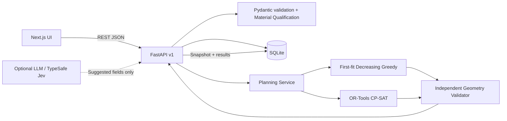

# PRD Backend — LoopCut AI

**Versi:** 1.0 / MVP JOINTS 2026  
**Rujukan:** [`prd.md`](./prd.md) · [`prd-frontend.md`](./prd-frontend.md) · [`prd-optimization.md`](./prd-optimization.md)  
**Stack usulan:** Python 3.11+, FastAPI, Pydantic v2, SQLAlchemy 2.x, SQLite untuk hackathon, OR-Tools CP-SAT, pytest.  
**Gaya API:** JSON over HTTP, path prefix `/api/v1`.

---

## 1. Objective dan non-goals

Backend mengelola stok kain sisa, pesanan komponen, verifikasi kualitas informasi, pemanggilan optimizer, penyimpanan snapshot perhitungan, dan laporan perbandingan baseline vs hasil terbaik yang ditemukan.

**Prinsip wajib:**

1. **Server authoritative:** frontend tidak menentukan kelayakan bahan, status solver, atau koordinat pemotongan.
2. **Deterministic + reproducible:** seed, input snapshot, versi strategi, dan runtime dicatat.
3. **Fail safely:** input invalid ditolak; solusi gagal validasi tidak dikirim sebagai rencana sah.
4. **No fabricated impact:** tidak ada endpoint pengurangan CO₂ atau “hemat biaya” tanpa parameter dan metodologi yang sah.
5. **Simulation only:** menjalankan plan **tidak** merubah kuantitas stok, tidak membuat pembelian, dan tidak memesan kain.

Di luar MVP: user auth multi organisasi, integrasi ERP, engine vision, kontrol mesin potong, forecasting demand, marketplace, rekonsiliasi stok otomatis.

## 2. Arsitektur



### Folder structure yang dianjurkan

```text
backend/
  app/
    main.py
    core/config.py
    db/session.py
    models/{remnant.py,order.py,plan_run.py}
    schemas/{remnant.py,order.py,plan.py,error.py}
    api/{health.py,remnants.py,orders.py,plan_runs.py}
    services/{qualification.py,planning.py}
    optimization/{compatibility.py,greedy.py,cp_sat.py,validator.py,metrics.py}
    demo/seed.py
  tests/
    test_remnants.py
    test_orders.py
    test_qualification.py
    test_geometry.py
    test_optimizer.py
    test_api_end_to_end.py
  requirements.txt
  README.md
```

## 3. Data contract & aturan bersama

### 3.1 Remnant

Satu record mewakili **satu lembar kain**, bukan satu timbangan/lot yang belum dibagi menjadi lembar. Jika CSV memuat `quantity=3`, import P1 harus membuat 3 instance berbeda (bukan `quantity=3` pada satu kotak di solver).

```json
{
  "id": "r_01",
  "code": "REM-001",
  "lot_code": "LOT-2026-10-A",
  "material_code": "COTTON",
  "color_code": "BLACK",
  "width_mm": 1200,
  "height_mm": 800,
  "verification_status": "VERIFIED",
  "stock_status": "AVAILABLE",
  "condition_note": "Lembar bersih, ukuran diukur manual",
  "source_note": "Offcut produksi batch A",
  "created_at": "2026-10-13T08:00:00+07:00",
  "updated_at": "2026-10-13T08:00:00+07:00"
}
```

**Required user fields:** `code`, `material_code`, `color_code`, `width_mm`, `height_mm`. `id`, timestamps, statuses dibuat/diatur server.

**Enums:**
- `verification_status`: `NEEDS_REVIEW`, `VERIFIED`.
- `stock_status`: `AVAILABLE`, `QUARANTINED`, `ARCHIVED`.

**Normalisasi:** `material_code` dan `color_code` adalah identifier terkontrol/ternormalisasi UPPERCASE; contoh `COTTON`, `POLYESTER`, `DENIM` dan `BLACK`, `NAVY`. Identitas lebih spesifik boleh dipakai (misalnya `COTTON_PLAIN_150GSM`) **hanya** jika kode sama persis pada remnant dan order. `DENIM` tidak otomatis dianggap kompatibel dengan `COTTON`.

**Qualification gate:** eligible bila status `VERIFIED` + `AVAILABLE`, width/height valid, material/color ada. Catatan kondisi ambigu tanpa verifikasi tidak membuktikan layak. Perubahan pada field material, color, dimensi, atau condition mengembalikan status ke `NEEDS_REVIEW` **kecuali** operator melakukan konfirmasi eksplisit `verification_status=VERIFIED` pada PATCH yang sama.

### 3.2 Order & order lines

```json
{
  "id": "o_01",
  "name": "Pesanan aksesori tote bag",
  "created_at": "2026-10-13T08:05:00+07:00",
  "lines": [
    {
      "id": "ol_01",
      "label": "Panel depan",
      "material_code": "COTTON",
      "color_code": "BLACK",
      "width_mm": 600,
      "height_mm": 400,
      "quantity": 2,
      "allow_rotation_90": false
    },
    {
      "id": "ol_02",
      "label": "Saku dalam",
      "material_code": "COTTON",
      "color_code": "BLACK",
      "width_mm": 500,
      "height_mm": 300,
      "quantity": 1,
      "allow_rotation_90": true
    }
  ]
}
```

**Ekspansi unit:** `ol_01#1`, `ol_01#2`, `ol_02#1` merupakan `piece_instance_id` stabil dalam snapshot plan. **Tiap unit maksimal sekali ditempatkan**.

### 3.3 Validasi ukuran dan batas MVP

| Input | Aturan |
|---|---|
| `width_mm`, `height_mm` | Bilangan bulat `1..10000`; pecahan dan string nonnumeric ditolak |
| `quantity` per order line | Integer `1..30` |
| Total instance komponen | `1..30` per run |
| Total remnant disertakan | `0..15` per run; jika >15 jangan diam-diam memotong daftar |
| `solver_time_limit_sec` | Integer `1..8`, default 8 |
| Material / color code | String uppercase/alnum/underscore/hyphen; tidak boleh kosong; panjang dibatasi 64 |
| Identitas `code` remnant | Unik pada satu workspace |
| Harga/biaya, density, grain, kerf | Tidak digunakan di P0 |

Semua integer mm dan koordinat solver harus mempertahankan presisi; jangan menyimpan dimensi sebagai float. `area_m2` adalah nilai turunan untuk presentasi dan dapat dibulatkan ke 4 desimal pada UI, sedangkan perhitungan memakai `area_mm2` integer.

## 4. Database schema (SQLite)

### `remnants`

| Field | Tipe | Keterangan |
|---|---|---|
| id | TEXT PRIMARY KEY | UUID/string yang dibuat server |
| code | TEXT UNIQUE NOT NULL | Kode lembar |
| lot_code | TEXT NULL | Referensi lot asal |
| material_code | TEXT NOT NULL | Exact match |
| color_code | TEXT NOT NULL | Exact match |
| width_mm | INTEGER NOT NULL | >0 |
| height_mm | INTEGER NOT NULL | >0 |
| verification_status | TEXT NOT NULL | Enum |
| stock_status | TEXT NOT NULL | Enum |
| condition_note | TEXT NULL | Operator note |
| source_note | TEXT NULL | Provenance |
| created_at, updated_at | TEXT ISO-8601 | Timestamp timezone-aware |

### `orders`

`id`, `name`, `created_at`, `updated_at`.

### `order_lines`

`id`, `order_id` FK, `label`, `material_code`, `color_code`, `width_mm`, `height_mm`, `quantity`, `allow_rotation_90`.

### `plan_runs`

| Field | Tipe | Keterangan |
|---|---|---|
| id | TEXT PK | Plan ID |
| order_id | TEXT FK | Order asal |
| input_snapshot_json | TEXT NOT NULL | Order + remnants + solver config saat run |
| baseline_result_json | TEXT NOT NULL | Output greedy tervalidasi |
| selected_result_json | TEXT NOT NULL | Output optimizer/baseline terpilih |
| solver_status | TEXT NOT NULL | Status user-facing |
| selected_strategy | TEXT NOT NULL | `OPTIMIZER` / `GREEDY` |
| solver_metadata_json | TEXT NOT NULL | Runtime, seed, solver return status, objective, dll. |
| comparison_json | TEXT NOT NULL | Selisih metrik |
| warnings_json | TEXT NOT NULL | Informasi validasi, keterbatasan |
| created_at | TEXT ISO-8601 | Timestamp |

**Snapshot immutable:** historis plan tetap sama ketika stok/order diedit setelah run; status stok aktual dapat berubah, tetapi tampilan historis tidak menulis ulang solusi.

## 5. REST API — P0

### 5.1 Health

`GET /api/v1/health` → `200`

```json
{"status":"ok","service":"loopcut-backend","version":"1.0.0"}
```

### 5.2 Inventory

`GET /api/v1/remnants?material_code=COTTON&stock_status=AVAILABLE&verification_status=VERIFIED`

```json
{"items":[{"id":"r_01","code":"REM-001","material_code":"COTTON","color_code":"BLACK","width_mm":1200,"height_mm":800,"verification_status":"VERIFIED","stock_status":"AVAILABLE"}],"total":1}
```

`POST /api/v1/remnants` → `201` mengembalikan Remnant. Request:

```json
{"code":"REM-001","lot_code":"LOT-A","material_code":"COTTON","color_code":"BLACK","width_mm":1200,"height_mm":800,"condition_note":"Lembar masih utuh","source_note":"Stok potongan produksi"}
```

**Pembuatan default:** `verification_status=NEEDS_REVIEW`, `stock_status=AVAILABLE`.

`PATCH /api/v1/remnants/{id}` → `200`. Contoh tindakan verifikasi:

```json
{"verification_status":"VERIFIED"}
```

Perubahan material/warna/dimensi harus otomatis mereset ke review kecuali payload menegaskan verifikasi ulang. `ARCHIVED` tidak dipakai oleh optimizer; tidak perlu DELETE fisik pada MVP.

### 5.3 Orders

`GET /api/v1/orders` → daftar ringkas.

`POST /api/v1/orders` → `201` dengan body:

```json
{
  "name":"Pesanan tote bag",
  "lines":[
    {"label":"Panel depan","material_code":"COTTON","color_code":"BLACK","width_mm":600,"height_mm":400,"quantity":2,"allow_rotation_90":false}
  ]
}
```

`GET /api/v1/orders/{id}` → detail termasuk `lines`.

**MVP:** order dibuat baru untuk revisi; tidak wajib endpoint edit agar snapshot dan semantik plan sederhana.

### 5.4 Plan runs

`POST /api/v1/plan-runs` → `201` (request synchronous):

```json
{
  "order_id":"o_01",
  "remnant_ids":["r_01","r_02"],
  "solver_time_limit_sec":8
}
```

Jika `remnant_ids` dihilangkan/null, backend menggunakan semua stock eligible **hanya bila jumlahnya ≤15**. Jika lebih, kembalikan `422 REMNANT_SELECTION_REQUIRED`, dan UI harus meminta pengguna memilih maksimal 15 stok. Jika request berisi ID unverified/quarantined, keluarkan dari kandidat, catat `excluded_remnants` beserta alasannya; jangan diam-diam memakainya.

**Respons contoh (strukturnya normatif, angka hanya ilustrasi data demo):**

```json
{
  "id": "pr_01",
  "order_id": "o_01",
  "created_at": "2026-10-13T08:10:00+07:00",
  "solver_status": "OPTIMAL",
  "selected_strategy": "OPTIMIZER",
  "solver_metadata": {
    "engine": "ortools-cpsat",
    "engine_version": "configured-at-runtime",
    "random_seed": 2026,
    "time_limit_sec": 8,
    "wall_time_sec": 0.21,
    "raw_solver_status": "OPTIMAL"
  },
  "input_snapshot": {
    "order": {"id":"o_01","name":"Pesanan tote bag","lines":[{"id":"ol_01","label":"Panel depan","material_code":"COTTON","color_code":"BLACK","width_mm":600,"height_mm":400,"quantity":2,"allow_rotation_90":false}]},
    "remnants": [{"id":"r_01","code":"REM-001","material_code":"COTTON","color_code":"BLACK","width_mm":1200,"height_mm":800,"verification_status":"VERIFIED","stock_status":"AVAILABLE"}],
    "solver_time_limit_sec": 8
  },
  "baseline": {
    "placements": [
      {"piece_instance_id":"ol_01#1","order_line_id":"ol_01","remnant_id":"r_01","x_mm":0,"y_mm":0,"placed_width_mm":600,"placed_height_mm":400,"rotated":false},
      {"piece_instance_id":"ol_01#2","order_line_id":"ol_01","remnant_id":"r_01","x_mm":600,"y_mm":0,"placed_width_mm":600,"placed_height_mm":400,"rotated":false}
    ],
    "unallocated": [],
    "metrics": {"reuse_area_mm2":480000,"reuse_area_m2":0.48,"unallocated_area_mm2":0,"unallocated_area_m2":0.0,"area_coverage_pct":100.0,"count_coverage_pct":100.0,"placed_count":2,"requested_count":2,"used_remnant_count":1}
  },
  "selected": {
    "placements": [
      {"piece_instance_id":"ol_01#1","order_line_id":"ol_01","remnant_id":"r_01","x_mm":0,"y_mm":0,"placed_width_mm":600,"placed_height_mm":400,"rotated":false},
      {"piece_instance_id":"ol_01#2","order_line_id":"ol_01","remnant_id":"r_01","x_mm":600,"y_mm":0,"placed_width_mm":600,"placed_height_mm":400,"rotated":false}
    ],
    "unallocated": [],
    "metrics": {"reuse_area_mm2":480000,"reuse_area_m2":0.48,"unallocated_area_mm2":0,"unallocated_area_m2":0.0,"area_coverage_pct":100.0,"count_coverage_pct":100.0,"placed_count":2,"requested_count":2,"used_remnant_count":1}
  },
  "comparison": {"gain_vs_greedy_mm2":0,"gain_vs_greedy_m2":0.0,"gain_vs_greedy_count":0},
  "excluded_remnants": [],
  "warnings": ["Scenario/simulasi: tidak mengurangi stok dan tidak memodelkan kerf atau biaya pembelian."]
}
```

**Penting:** contoh ini sengaja menunjukkan **hasil seri**: dua potongan `600×400` muat pada kain `1200×800`, sehingga baseline yang benar juga harus mampu menempatkan keduanya. Nilai `gain=0` adalah hasil yang sah; jangan memalsukan peningkatan demi demo. Seluruh angka contoh masih merupakan ilustrasi kontrak API, bukan hasil benchmark yang telah dijalankan.

`GET /api/v1/plan-runs/{id}` → objek persis sama yang telah disimpan.

### 5.5 Error contract

| HTTP | `error.code` | Kondisi |
|---|---|---|
| 400 | `BAD_REQUEST` | JSON malformed |
| 404 | `NOT_FOUND` | ID tidak ada |
| 409 | `DUPLICATE_REMNANT_CODE` | Kode stok bentrok |
| 422 | `VALIDATION_ERROR` | Pydantic/aturan dimensi |
| 422 | `REMNANT_SELECTION_REQUIRED` | Eligible stock >15 tanpa pilihan eksplisit |
| 422 | `TOO_MANY_PIECES` | Expand quantity >30 |
| 500 | `INTERNAL_ERROR` | Error tak terduga, log tanpa membocorkan rahasia |

```json
{"error":{"code":"VALIDATION_ERROR","message":"Lebar harus lebih besar dari 0 mm.","details":{"field":"width_mm"}}}
```

## 6. Planner orchestration (source of truth)

```text
validate request
  → load order + snapshots of requested remnants
  → qualification gate + collect excluded reasons
  → expand order lines into individual pieces
  → exact-match material/color + dimensions + rotation options
  → run deterministic greedy baseline
  → validate greedy geometry + recompute metrics server-side
  → run CP-SAT (time limit 1–8 s, deterministic seed)
  → validate every solver result independently
  → compare lexicographic objective fairly
  → choose better valid result, otherwise greedy fallback
  → classify solver_status without exaggeration
  → persist immutable snapshot and response atomically
```

Jika tidak ada kandidat compatible, `selected` dan `baseline` tetap ada dengan `placements=[]`, daftar `unallocated` lengkap, `solver_status=NO_ASSIGNABLE_PIECES`.

`selected_strategy` tidak boleh mengaku `OPTIMIZER` jika hasil yang akhirnya ditampilkan adalah greedy. Bila optimizer feasible tetapi tidak lebih baik dari greedy pada batas waktu, pilih greedy dan tandai `BASELINE_FALLBACK` + warning.

## 7. Status & semantics (jangan disederhanakan)

| `solver_status` | Arti |
|---|---|
| `OPTIMAL` | CP-SAT melaporkan optimum, hasil lolos validator, dan dipilih |
| `FEASIBLE_TIMEOUT` | Ada solusi CP-SAT valid yang dipilih, tetapi belum terbukti optimal |
| `BASELINE_FALLBACK` | Greedy valid dipilih karena optimizer tidak memberi solusi lebih baik/valid dalam budget |
| `NO_ASSIGNABLE_PIECES` | Tidak ada unit yang memenuhi syarat untuk ditempatkan pada stok eligible |

`raw_solver_status` terpisah: `OPTIMAL`, `FEASIBLE`, `UNKNOWN`, `MODEL_INVALID`, `ERROR`, atau `SKIPPED`. Status `UNKNOWN` **bukan** bukti tidak ada solusi. Jika solver tidak menyediakan bound yang sah, jangan buat `optimality_gap` palsu.

## 8. Material qualification & explainability

**P0 deterministic:**
- Cek verifikasi stok dan status stok.
- Cek exact match `material_code` dan `color_code`.
- Cek 0°/90° sesuai field order dan dimensi.
- Jika tak tersedia pasangan kompatibel secara material, reason `NO_VERIFIED_MATERIAL_MATCH`.
- Jika ada material cocok tetapi dimensi unit tidak muat pada lembar mana pun (termasuk rotasi yang boleh), reason `DOES_NOT_FIT_ANY_COMPATIBLE_REMNANT`.
- Selain itu, jika tetap tak teralokasi karena pengepakan/waktu pencarian, reason `UNALLOCATED_AFTER_SEARCH`.

**P2 opsional LLM/Jev:** endpoint `/api/v1/material-extractions` boleh dikerjakan setelah P0. Hanya mengusulkan struktur data dari catatan teks; tidak mengubah `VERIFIED` otomatis, tidak menyimpulkan komposisi serat tanpa bukti, dan harus bisa dimatikan lewat environment variable.

## 9. Security & operational safeguards

- `CORS_ORIGINS` harus eksplisit pada deployment; jangan wildcard sembarang untuk API publik.
- AI keys hanya di backend, tidak pernah di `NEXT_PUBLIC_*`.
- Sanitasi string untuk log/UI; query SQL lewat ORM, bukan interpolasi.
- Batasi ukuran payload (contoh ≤256 KB), jumlah items, solver time, dan rate limit pada endpoint plan jika dipublikasikan.
- **Tidak ada auth production-grade di P0:** deployment publik wajib diberi pembatasan akses demo/reverse proxy atau kontrol reset workspace; jangan menyatakan cocok dipakai multi-perusahaan.
- Logging: request ID, error class, runtime, jumlah item/remnant; tidak perlu menyimpan data pribadi.
- Gunakan timeout request upstream yang sedikit lebih panjang daripada solver; jangan membiarkan request menggantung.
- SQLite cukup untuk demo single-user; produksi perlu database/migrasi/perizinan yang lebih kuat.

## 10. Automated tests yang wajib

### Unit

- Reject width ≤0, invalid quantity, >30 total pieces, >15 remnant.
- Perubahan field material pada `VERIFIED` menjadi `NEEDS_REVIEW` secara default.
- Remnant `NEEDS_REVIEW`, `QUARANTINED`, atau `ARCHIVED` tidak boleh dipakai.
- Material/warna mismatch ditolak.
- Rotasi 90° hanya bila diizinkan.
- Validasi layout containment, non-overlap, unique assignment, consistent orientation.
- Recompute area dari **dimensi original piece**, bukan dari volume bounding box salah.
- Hasil solver `UNKNOWN` dipetakan ke fallback dengan warning.

### Integration

1. POST remnant (default review) → PATCH verified → POST order → POST plan → GET plan.
2. POST plan dengan 0 stok eligible → hasil empty yang informatif.
3. POST plan berisi stok excluded → excluded tercatat, tidak digunakan.
4. Simpan plan, edit remnant, GET plan historis → hasil tetap identik.
5. Skenario solver feasible/timeout → respons tidak pernah salah memberi label `OPTIMAL`.
6. 30+ skenario berseed → seluruh output lolos validator geometri independen.

## 11. Environment & menjalankan proyek

```dotenv
DATABASE_URL=sqlite:///./loopcut.db
CORS_ORIGINS=http://localhost:3000
SOLVER_TIME_LIMIT_SEC=8
SOLVER_RANDOM_SEED=2026
ENABLE_AI_EXTRACTION=false
DEMO_MODE=true
# TYPESAFE_API_KEY=...  (hanya jika fitur opsional dibuat)
```

```bash
cd backend
python -m venv .venv
# aktifkan virtualenv sesuai OS
pip install -r requirements.txt
uvicorn app.main:app --reload --port 8000
pytest -q
```

Backend otomatis menyediakan Swagger UI di `/docs` untuk testing endpoint. Data demo seed harus dijalankan eksplisit, jangan overwrite data tanpa konfirmasi.

## 12. Deliverables backend & Definition of Done

- [ ] API health, remnants, orders, plan-runs tersedia dan didokumentasikan.
- [ ] Schema di bagian 3–5 sama persis dengan FE; tidak ada field duplikat dengan nama berbeda.
- [ ] Semua input server-side tervalidasi.
- [ ] Qualification gate mencegah stok belum diverifikasi digunakan.
- [ ] Baseline greedy dan CP-SAT diintegrasikan memakai kontrak hasil sama.
- [ ] Validator independen dijalankan **sebelum menyimpan/menampilkan** hasil.
- [ ] Plan-run immutable, status dan solver metadata tersimpan.
- [ ] Test end-to-end lulus dan minimal 30 skenario seeded diekspor.
- [ ] Backend tetap bekerja tanpa API eksternal/AI.

## 13. Catatan untuk demo yang jujur

- Data seed/skenario adalah **data sintetis** sampai tersedia data lapangan yang diizinkan.
- `reuse_area_m2` adalah luas komponen yang teralokasi, tidak identik dengan pengurangan pembelian kain baru.
- `gain_vs_greedy_m2` adalah selisih terhadap baseline **pada skenario yang sama**, tidak boleh ditafsirkan sebagai peningkatan universal.
- `OPTIMAL` hanya bila solver membuktikannya.
