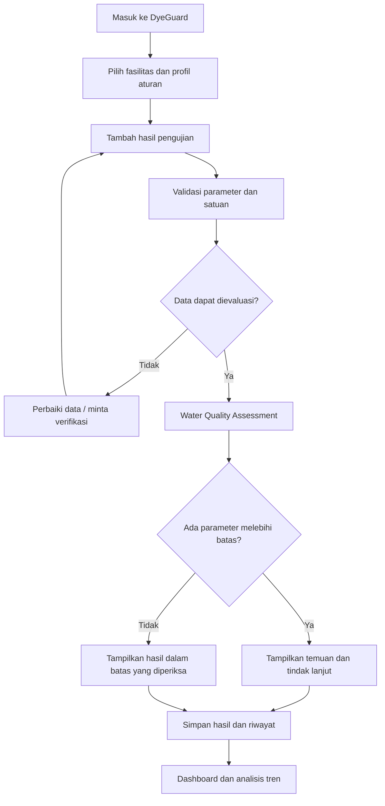

# DyeGuard AI — Textile Wastewater Intelligence

**Parent Platform:** LoopCut AI / TexLoop AI  
**Module:** DyeGuard — Water Quality Monitoring & Decision Support  
**Priority:** P1 — Pengembangan setelah MVP LoopCut  
**Status:** Planned Feature  
**Category:** Sustainability — Textile Waste Management

---

## 1. Overview

**DyeGuard AI** adalah modul pengelolaan kualitas air limbah industri tekstil yang membantu operator mengevaluasi hasil pengujian laboratorium, mengidentifikasi parameter pencemar yang melebihi baku mutu, memantau efektivitas pengolahan, dan menentukan tindak lanjut pemeriksaan yang diperlukan.

DyeGuard dirancang untuk melengkapi LoopCut AI dalam satu platform keberlanjutan industri tekstil.

- **LoopCut:** Mengurangi potensi limbah padat melalui pemanfaatan ulang kain sisa produksi.
- **DyeGuard:** Membantu mengelola risiko pencemaran air dari proses pencelupan, pencucian, printing, dan finishing tekstil.

DyeGuard merupakan *decision-support system*, bukan sistem otomatis yang menjamin air limbah aman dibuang atau menggantikan pengujian laboratorium.

## 2. Problem Statement

Proses produksi tekstil, khususnya pewarnaan dan finishing, dapat menghasilkan air limbah yang mengandung zat pewarna, bahan organik, padatan tersuspensi, serta senyawa kimia lainnya.

Beberapa tantangan yang ingin ditangani:

1. Hasil pengujian kualitas air dicatat secara manual dan tersebar dalam berbagai laporan.
2. Operator kesulitan memahami parameter yang bermasalah dan persyaratan baku mutu yang relevan.
3. Tidak tersedia pemantauan historis yang mudah digunakan untuk mengevaluasi kualitas air sebelum dan sesudah pengolahan.
4. Tindak lanjut ketika parameter melebihi batas belum selalu terdokumentasi secara sistematis.
5. UMKM tekstil tidak selalu memiliki akses terhadap tenaga ahli lingkungan secara langsung.

**Bukti masalah:**

Penelitian Alam dkk. (2024) pada Sungai Loji di Indonesia menemukan 54 jenis zat pewarna, dengan 12 di antaranya dikonfirmasi menggunakan standar referensi.

Referensi: https://doi.org/10.1016/j.chemosphere.2024.143324

Angka penelitian tersebut merupakan temuan lokasi studi dan tidak boleh dianggap sebagai kondisi seluruh industri tekstil Indonesia.

## 3. Target Users

### Primary Users

**Operator IPAL / Petugas Lingkungan Industri Tekstil**

- Mencatat hasil pengujian laboratorium.
- Memantau parameter air limbah.
- Mengidentifikasi hasil yang memerlukan pemeriksaan.
- Mencatat tindakan korektif dan pengujian ulang.

### Secondary Users

**Pemilik UMKM Batik dan Industri Pewarnaan**

- Memahami kondisi hasil pengujian air limbah.
- Melihat ringkasan risiko lingkungan.
- Memantau perkembangan kualitas air setelah pengolahan.

**Manajer Produksi / Environmental Officer**

- Memantau hasil pengujian dari waktu ke waktu.
- Mengevaluasi efektivitas proses IPAL.
- Meninjau riwayat temuan dan tindak lanjut.

## 4. Core Features

### 4.1 Wastewater Sample Management — P1

Pengguna dapat memasukkan hasil pengujian air limbah.

**Input utama:**

| Field | Tipe | Keterangan |
|---|---|---|
| Sample ID | String | Kode unik sampel |
| Sample Date | Datetime | Waktu pengambilan sampel |
| Facility | String | Nama fasilitas |
| Sampling Point | Enum | INFLUENT / EFFLUENT / INTERNAL |
| Treatment System | String | Jenis sistem pengolahan |
| pH | Number | Derajat keasaman |
| BOD | Number | mg/L |
| COD | Number | mg/L |
| TSS | Number | mg/L |
| Color | Number | Pt-Co, jika menggunakan metode tersebut |
| Laboratory Reference | String | Nomor atau identitas laporan laboratorium |
| Notes | Text | Keterangan tambahan |

**Functional requirements:**

- Pengguna dapat menambah dan melihat sampel.
- Validasi satuan dan tipe data dilakukan sebelum penyimpanan.
- Parameter yang belum diuji dicatat sebagai `null`, bukan nol.
- Hasil laboratorium dapat ditandai sebagai terverifikasi.
- Semua perubahan data tersimpan dalam riwayat audit.
- Sistem membedakan sampel sebelum pengolahan, setelah pengolahan, dan titik pemantauan internal.

### 4.2 Water Quality Assessment Engine — P1

Engine membandingkan hasil pengujian dengan aturan baku mutu yang sesuai.

**Workflow:**

1. Pengguna memilih profil fasilitas.
2. Sistem menentukan profil aturan yang relevan.
3. Hasil pengujian divalidasi.
4. Parameter dibandingkan dengan ambang batas.
5. Sistem menghasilkan status setiap parameter.
6. Parameter yang belum diuji ditandai sebagai informasi yang belum lengkap.

**Status penilaian:**

- `WITHIN_LIMIT`: Parameter berada dalam batas yang dipilih.
- `EXCEEDS_LIMIT`: Parameter melebihi batas.
- `MISSING_DATA`: Data parameter wajib belum tersedia.
- `NOT_APPLICABLE`: Parameter atau ketentuan tidak berlaku pada profil tersebut.
- `REQUIRES_REVIEW`: Profil aturan, satuan, atau kualitas data perlu diperiksa.

Status per parameter tidak sama dengan sertifikasi kepatuhan keseluruhan fasilitas.

**Referensi regulasi:**

Peraturan Menteri Lingkungan Hidup/BPLH Nomor 12 Tahun 2025 tentang baku mutu air limbah industri tekstil.

https://peraturan.bpk.go.id/

Implementasi wajib memeriksa dokumen regulasi resmi beserta lampirannya, kategori kegiatan, jenis pengolahan, debit, titik pembuangan, persyaratan izin, dan ketentuan yang berlaku pada fasilitas.

Nilai ambang batas tidak boleh dibuat oleh LLM atau diterapkan sama pada seluruh fasilitas.

### 4.3 Risk & Action Insights — P1

Sistem memberikan penjelasan terhadap hasil pemeriksaan.

**Contoh output:**

- COD terukur lebih tinggi daripada batas profil yang dipilih.
- Pemeriksaan kinerja proses IPAL diperlukan.
- Data BOD belum tersedia sehingga evaluasi keseluruhan belum lengkap.
- Disarankan melakukan pengujian ulang sesuai prosedur fasilitas.

Rekomendasi dibatasi pada tindak lanjut pemeriksaan dan dokumentasi yang didukung aturan atau referensi.

Sistem tidak boleh memberikan dosis bahan kimia, mengizinkan pembuangan, atau mengubah setpoint IPAL secara otomatis.

### 4.4 Water Quality Dashboard — P1

Dashboard menampilkan:

- Jumlah sampel yang dicatat.
- Jumlah sampel dengan parameter melebihi batas.
- Parameter yang paling sering memerlukan pemeriksaan.
- Tren pH, BOD, COD, TSS, dan warna.
- Riwayat kualitas air dari masing-masing titik pengambilan sampel.
- Status tindak lanjut operator.
- Data pengujian yang belum lengkap.

Visualisasi menggunakan grafik garis, tabel historis, dan indikator status.

**Catatan:** Grafik harus membedakan titik `INFLUENT` dan `EFFLUENT`. Jangan mencampurkan data dari titik atau metode pengukuran berbeda tanpa informasi yang jelas.

### 4.5 Before–After Treatment Analysis — P1

DyeGuard membantu mengevaluasi perubahan parameter air limbah antara sebelum dan sesudah proses pengolahan.

**Formula:**

\[
\text{Removal Efficiency} =
\frac{C_{in}-C_{out}}{C_{in}}\times100\%
\]

Keterangan:

- `C_in`: Konsentrasi parameter sebelum pengolahan.
- `C_out`: Konsentrasi parameter setelah pengolahan.

Penghitungan hanya dilakukan ketika kedua hasil pengujian dapat dibandingkan, termasuk kesesuaian satuan, metode, titik, dan waktu pengambilan sampel. Nilai awal harus lebih dari nol.

Contoh ilustratif:

- COD sebelum pengolahan: 400 mg/L.
- COD sesudah pengolahan: 100 mg/L.
- Removal efficiency: 75%.

Hasil tersebut menunjukkan penurunan konsentrasi COD sebesar 75% dalam contoh, bukan bukti bahwa air otomatis aman dibuang.

Perhitungan pengurangan beban pencemar dalam kg memerlukan informasi volume atau debit air yang sesuai.

### 4.6 AI Laboratory Report Extraction — P2

Pengguna dapat mengunggah laporan pengujian laboratorium dalam format PDF atau gambar.

**Teknologi:**

- OCR / document extraction.
- LLM untuk mengubah teks menjadi atribut terstruktur.
- Zod atau Pydantic untuk schema validation.

**Workflow:**

Upload laporan → ekstraksi → pemeriksaan data → konfirmasi operator → penyimpanan sampel.

Hasil AI harus ditampilkan sebagai draft. Sistem tidak boleh otomatis menyatakan hasil laboratorium terverifikasi.

### 4.7 TypeSafe Jev Integration — P2

TypeSafe Jev dapat membantu menilai catatan operator yang tidak terstruktur.

**Contoh penggunaan:**

- `Jev Choice`: Mengkategorikan laporan masalah operasional berdasarkan kategori yang sudah ditentukan.
- `Jev Score`: Menilai kelengkapan narasi tindak lanjut berdasarkan rubrik.
- `Jev Noul`: Membantu mengevaluasi ketidakpastian suatu pernyataan tekstual jika relevan dan telah diuji.

**Batasan:**

Jev tidak digunakan sebagai pengganti perbandingan numerik terhadap baku mutu, analisis laboratorium, atau validasi ahli.

### 4.8 Treatment Evidence Library — P2

Modul referensi penelitian yang membantu pengguna memahami opsi pengolahan yang pernah diteliti.

Informasi yang ditampilkan:

- Jenis teknologi pengolahan.
- Parameter pencemar yang diteliti.
- Karakteristik air limbah.
- Hasil eksperimen yang dipublikasikan.
- Kebutuhan pengujian tambahan.
- Keterbatasan penelitian.
- DOI atau tautan sumber.

Contoh kategori teknologi:

- Adsorption.
- Coagulation / flocculation.
- Biological treatment.
- Electrocoagulation.
- Membrane filtration.

Modul tidak otomatis menetapkan teknologi tertentu sebagai yang terbaik untuk fasilitas tanpa analisis dan pengujian yang relevan.

## 5. Application User Flow

## 6. Frontend Requirements

**Framework:** Next.js App Router, TypeScript, Tailwind CSS, shadcn/ui.

**Pages:**

| Route | Description |
|---|---|
| `/dyeguard` | Water quality overview |
| `/dyeguard/samples` | Daftar sampel air limbah |
| `/dyeguard/samples/new` | Form input pengujian |
| `/dyeguard/samples/[id]` | Detail hasil pengujian |
| `/dyeguard/assessments/[id]` | Laporan penilaian kualitas air |
| `/dyeguard/analytics` | Grafik historis dan efektivitas pengolahan |

**UI Requirements:**

- Antarmuka berbahasa Indonesia.
- Form dengan validasi.
- Status setiap parameter mudah dipahami.
- Loading, error, dan empty state.
- Tabel dapat digunakan pada perangkat mobile.
- Data sintetis diberi penanda jelas.
- Pengguna dapat melihat sumber dan versi aturan penilaian.
- Hasil penilaian tidak dinyatakan sebagai sertifikat kepatuhan.

## 7. Backend Requirements

**Framework:** FastAPI + Pydantic.

**API Prefix:** `/api/v1/dyeguard`

**Endpoint awal yang direncanakan:**

| Method | Endpoint | Fungsi |
|---|---|---|
| GET | `/facilities` | Daftar fasilitas |
| POST | `/facilities` | Tambah fasilitas |
| GET | `/samples` | Daftar sampel |
| POST | `/samples` | Simpan sampel |
| GET | `/samples/{id}` | Detail sampel |
| POST | `/assessments` | Jalankan evaluasi sampel |
| GET | `/assessments/{id}` | Hasil evaluasi |
| GET | `/analytics` | Data agregasi dashboard |
| GET | `/regulation-profiles` | Profil aturan yang tersedia |

**Penyimpanan utama:**

- `wastewater_facilities`
- `wastewater_samples`
- `wastewater_measurements`
- `regulation_profiles`
- `regulation_limits`
- `water_assessments`
- `assessment_findings`
- `corrective_actions`

Hasil penilaian menyimpan snapshot pengukuran, sumber serta versi regulasi, dan waktu evaluasi agar hasil historis tetap dapat ditelusuri.

DyeGuard memiliki model data dan service sendiri tanpa mengubah kontrak optimizer LoopCut.

## 8. Business Rules

1. Nilai numerik harus valid dan satuannya diketahui.
2. Parameter yang tidak diukur tidak boleh dianggap memenuhi batas.
3. Nilai pH diperiksa terhadap rentang minimum dan maksimum.
4. Pemeriksaan terhadap baku mutu pembuangan hanya berlaku pada sampel dari titik dan kategori yang sesuai.
5. Sistem tidak boleh menyatakan keseluruhan air limbah aman jika data wajib belum lengkap.
6. Setiap aturan baku mutu harus memiliki sumber, versi, dan tanggal keberlakuan.
7. Hasil laboratorium harus dapat dikoreksi dengan catatan perubahan.
8. Rekomendasi AI tidak boleh mengubah hasil pemeriksaan numerik.
9. Seluruh hasil demo sintetis harus dibedakan dari pengujian aktual.
10. Data fasilitas dan laporan laboratorium tidak boleh dikirim ke penyedia AI eksternal tanpa persetujuan dan kebijakan perlindungan data yang sesuai.

## 9. Non-Goals

Fitur berikut tidak termasuk MVP DyeGuard:

- Sensor IoT real-time.
- Kontrol otomatis mesin IPAL.
- Penentuan dosis bahan kimia otomatis.
- Prediksi keamanan air hanya berdasarkan foto.
- Penggantian pengujian laboratorium.
- Sertifikasi kepatuhan lingkungan.
- Prediksi konsentrasi pencemar menggunakan ML tanpa dataset yang memadai.
- Penjaminan efisiensi teknologi pengolahan pada semua fasilitas.

## 10. Success Metrics

| Metric | Measurement |
|---|---|
| Assessment Accuracy | Kesamaan hasil pemeriksaan dengan perhitungan referensi yang sudah diverifikasi |
| Missing Data Detection | Persentase parameter wajib yang tidak tersedia dan berhasil ditandai |
| Unit Validation Accuracy | Ketepatan validasi satuan dan rentang input |
| Assessment Processing Time | Waktu sistem menghasilkan evaluasi |
| Historical Data Integrity | Konsistensi hasil dan snapshot setelah data diperbarui |
| User Task Completion | Kemampuan operator menyelesaikan alur input hingga membaca hasil |

**Environmental impact metrics untuk pengembangan lanjutan:**

- Perubahan konsentrasi parameter sebelum dan sesudah pengolahan.
- Persentase pengujian yang memenuhi parameter dalam profil evaluasi.
- Tren jumlah hasil pengujian yang membutuhkan tindak lanjut.
- Pengurangan beban pencemar jika data konsentrasi dan debit yang relevan tersedia.

Indikator tersebut baru dapat digunakan untuk mengklaim dampak lapangan setelah pengujian dan data operasional yang memadai tersedia.

## 11. Acceptance Criteria

DyeGuard Lite dinyatakan selesai apabila:

- Pengguna dapat memasukkan dan menyimpan hasil pengujian air limbah.
- Sistem memvalidasi tipe data, nilai, dan satuan.
- Profil aturan penilaian dapat dipilih dan sumbernya ditampilkan.
- Sistem mengidentifikasi parameter di dalam atau di luar batas.
- Data yang tidak lengkap tidak dianggap memenuhi baku mutu.
- Hasil assessment dapat dibuka kembali.
- Riwayat pengukuran dapat ditampilkan dalam grafik.
- Perbandingan sebelum–sesudah menggunakan sampel yang dapat dibandingkan.
- Pengujian unit untuk nilai batas, data hilang, profil salah, dan pH di luar rentang berhasil.
- Modul DyeGuard tidak merusak fitur inventaris atau optimizer LoopCut.
- Aplikasi membedakan secara jelas data sintetis dan data aktual.

## 12. Development Roadmap

### P1 — DyeGuard Lite

Fokus pada fitur yang dapat berfungsi tanpa ML:

- Input hasil laboratorium.
- Profil fasilitas dan aturan penilaian.
- Water Quality Assessment Engine.
- Dashboard tren kualitas air.
- Riwayat sampel dan hasil penilaian.
- Before–after analysis.
- Unit dan integration testing.

### P2 — AI-Assisted Wastewater Intelligence

- Ekstraksi laporan laboratorium menggunakan LLM.
- TypeSafe Jev untuk catatan operator.
- Treatment Evidence Library.
- Tindak lanjut pemeriksaan berbasis referensi.
- Dokumentasi tindakan korektif.

### P3 — Advanced Treatment Intelligence

- Integrasi data sensor terverifikasi.
- Analisis anomali historis.
- Model prediksi berbasis data operasional yang memadai.
- Perencanaan eksperimen pengolahan.
- Analisis peluang penggunaan kembali air setelah verifikasi keselamatan dan kesesuaian regulasi.

## 13. Integration with LoopCut AI

DyeGuard dikembangkan sebagai modul mandiri dalam platform yang sama.

**Shared infrastructure:**

- Frontend application shell.
- Navigation dan dashboard.
- Authentication jika tersedia.
- Backend deployment.
- Database infrastructure.
- Design system.

**Independent services:**

- LoopCut Optimization Engine.
- DyeGuard Water Quality Assessment Engine.

Tidak ada dependensi langsung antara hasil cutting optimization dengan penilaian kualitas air.

Pemilik konveksi dapat menggunakan LoopCut tanpa DyeGuard. Fasilitas pencelupan atau pewarnaan dapat menggunakan DyeGuard tanpa memiliki stok kain sisa.

## 14. Product Value Proposition

**LoopCut AI** membantu industri tekstil mencegah pemborosan bahan kain melalui pemanfaatan ulang sisa produksi.

**DyeGuard AI** membantu industri tekstil mengenali masalah kualitas air limbah, mendokumentasikan hasil pengujian, dan mengevaluasi efektivitas pengolahan.

Keduanya membentuk fondasi platform yang mendukung praktik produksi tekstil lebih bertanggung jawab.

**Product Vision:**

> Membangun ekosistem Textile Sustainability Intelligence yang membantu pelaku industri tekstil mengambil keputusan berbasis data untuk mengurangi limbah padat dan mengelola risiko pencemaran air.

## 15. Prioritas Implementasi JOINTS 2026

DyeGuard hanya dikerjakan setelah alur inti LoopCut selesai dan teruji:

1. Inventaris kain sisa.
2. Material matching.
3. Cutting optimizer.
4. Cutting layout dan impact dashboard.
5. Pengujian dan integrasi backend.

Jika masih ada waktu, implementasikan DyeGuard Lite dengan data uji sintetis yang diberi label jelas.

**Prioritas utama tetap menjaga LoopCut sebagai solusi inti yang benar-benar berfungsi.** DyeGuard menjadi perluasan kemampuan produk, bukan alasan mengurangi kualitas optimizer atau validasi LoopCut.

---

**End of DyeGuard Feature Specification — P1/P2 Roadmap**