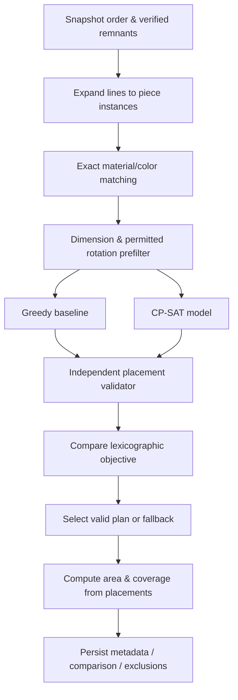

# PRD Optimization Engine — LoopCut AI

**Versi:** 1.0 / MVP JOINTS 2026  
**Fokus:** Verified remnant-to-order matching + rectangular cutting layout  
**Referensi kontrak:** [`prd-backend.md`](./prd-backend.md) · [`prd.md`](./prd.md)  
**Solver usulan:** Google OR-Tools **CP-SAT**, dengan baseline deterministic first-fit decreasing.

---

## 1. Tujuan optimasi

Diberikan sekumpulan **lembar kain sisa yang terverifikasi** dan sekumpulan **komponen persegi panjang dari pesanan yang memang dibutuhkan**, cari susunan pemotongan valid untuk mengalokasikan **luas komponen sebesar mungkin** dari stok kain sisa yang ada.

**Objective produk P0:** *maximize area of order components successfully assigned to verified remnants*. Tujuan ini **bukan** memaksimalkan luas semua bahan yang terpotong, dan **bukan** menghitung penghematan riil pembelian kain baru atau emisi.

### Mengapa objective ini dipilih?

- Terukur dengan unit tetap (mm²), relatif mudah diverifikasi.
- Tidak membutuhkan harga material/biaya proses yang belum ada.
- Menjelaskan dampak yang lebih langsung dibanding “AI classification accuracy”.
- Konsisten dengan baseline (input, filter, batasan, dan objective identik).

**Kebaruan yang ditargetkan (product/workflow):** qualification gate → matching bahan dan pesanan nyata → optimized reuse layout → baseline comparison + explainable rejects. Jangan mengklaim menemukan algoritma nesting pertama.

## 2. Definitions dan unit

| Simbol/field | Makna |
|---|---|
| `R` | Himpunan remnant eligible (`VERIFIED` + `AVAILABLE`) |
| `P` | Himpunan **piece instances** dari order (`sum(quantity)`) |
| `W_r`, `H_r` | Lebar dan tinggi remnant `r`, mm integer |
| `w_i`, `h_i` | Lebar dan tinggi potongan order unit `i`, mm integer |
| `A_i` | Luas potongan `w_i * h_i`, mm² |
| `a_ir` | Binary assignment potongan `i` ke remnant `r` |
| `rot_ir` | Binary rotasi 90° untuk potongan `i` jika ditempatkan pada `r` |
| `x_ir`, `y_ir` | Koordinat kiri-atas potongan pada remnant, mm |
| `z_r` | Binary apakah remnant `r` digunakan |
| `N` | Total piece instances, maksimum 30 |
| `M` | Total remnant yang diikutkan, maksimum 15 |

Satuan luas hasil: `area_m2 = area_mm2 / 1_000_000`.

**Coordinate system:** (0,0) di kiri-atas; x ke kanan; y ke bawah; rectangle menempati `[x,x+w] × [y,y+h]`. **Tepi bersinggungan diperbolehkan**, irisan area positif tidak boleh. Kerf/gap tidak dimodelkan pada P0.

## 3. Scope teknis MVP

**Didukung:**
- Multiple remnant ukuran bervariasi, setiap lembar satu container persegi panjang.
- Multiple line order dan quantity, diperluas ke ID per unit.
- Exact match material + color (menggunakan kode yang sudah diverifikasi).
- Pilihan rotasi 0° dan 90° **per order line**.
- Partial fulfillment: potongan yang belum muat tetap masuk laporan.
- Greedy baseline, CP-SAT search, geometry validation, reproducible benchmark.
- Time limit default 8 detik, random seed 2026.

**Tidak didukung:**
- Arbitrary 2D polygons, curve, holes, defect masking, fixed grain angle, motif directional yang rumit.
- Optimasi global pembelian kain baru, biaya operasional, penjadwalan jahit, dan mesin cutting.
- Clearance/kerf fisik: ukuran input adalah **ukuran potong final yang sudah mengakomodasi allowance yang diperlukan**.
- Analisis jenis material berdasarkan foto atau chemical composition prediction.

## 4. Pipeline algoritma



## 5. Compatibility preprocessing

Pasangan (`piece i`, `remnant r`) valid jika:

1. Stok remnant dalam snapshot memiliki `verification_status=VERIFIED` dan `stock_status=AVAILABLE`.
2. `material_code` sama **persis** setelah normalisasi.
3. `color_code` sama **persis**.
4. Ada orientasi yang diperbolehkan sehingga `placed_width ≤ W_r` dan `placed_height ≤ H_r`.

**Orientasi:**
- Tanpa rotasi: `(w_i, h_i)`.
- Dengan rotasi 90° (jika `allow_rotation_90=true`): `(h_i, w_i)`.
- Jika `w_i == h_i`, jangan menciptakan dua alternatif identik yang tidak diperlukan.

Pasangan yang gagal disaring **sebelum** dibawa ke solver agar model lebih kecil.

### Alasan pengecualian / unallocated

| Code | Arti yang dapat dipertanggungjawabkan |
|---|---|
| `NO_VERIFIED_MATERIAL_MATCH` | Tidak ada stok eligible dengan material **dan warna** yang sesuai |
| `DOES_NOT_FIT_ANY_COMPATIBLE_REMNANT` | Ada bahan/warna cocok, tetapi unit tidak muat secara dimensi pada satu lembar mana pun |
| `UNALLOCATED_AFTER_SEARCH` | Ada pasangan yang secara individu mungkin, tetapi unit belum ditempatkan oleh strategi yang dipilih |

`UNALLOCATED_AFTER_SEARCH` **tidak** otomatis berarti mustahil ditempatkan secara global; solver mungkin timeout atau strategi memilih subset lain.

## 6. Mathematical formulation (CP-SAT)

Untuk tiap pasangan feasible `(i, r)`:

- Binary `a_ir ∈ {0,1}`: unit `i` dipakai pada remnant `r`.
- Jika rotasi diperbolehkan, binary `rot_ir` dengan `rot_ir ≤ a_ir`; selain itu `rot_ir = 0`.
- Ukuran orientasi saat assigned:
  - `placed_w_ir = w_i + (h_i - w_i) * rot_ir`
  - `placed_h_ir = h_i + (w_i - h_i) * rot_ir`
- Buat optional interval vars untuk X dan Y dengan `presence=a_ir`, size `placed_w_ir` dan `placed_h_ir`; `x_ir`, `y_ir` integer >=0.
- Konstrain interval end ≤ batas dimensi container saat hadir; gunakan reified conditions atau domain yang sesuai.

### 6.1 Constraint assignment

Setiap unit hanya boleh ditempatkan sekali:

\[
\sum_{r \in R_i} a_{ir} \le 1 \quad \forall i \in P.
\]

`R_i` adalah himpunan remnant compatible untuk unit `i`.

### 6.2 Boundary

Ketika `a_ir = 1`:

\[
0 \le x_{ir},\quad x_{ir} + placed\_w_{ir} \le W_r,
\]
\[
0 \le y_{ir},\quad y_{ir} + placed\_h_{ir} \le H_r.
\]

### 6.3 Non-overlap

Untuk masing-masing remnant `r`, jalankan `AddNoOverlap2D(x_optional_intervals, y_optional_intervals)` pada semua pasangan yang mungkin ditempatkan di remnant itu. Kehadiran kedua optional interval harus dikontrol oleh **literal `a_ir` yang sama**.

**Invariant geometri:** untuk pasangan yang sama-sama dialokasikan pada remnant `r`, paling sedikit satu benar: kanan A ≤ kiri B; kanan B ≤ kiri A; bawah A ≤ atas B; atau bawah B ≤ atas A.

### 6.4 Used-remnant indicator

Buat `z_r ∈ {0,1}` dengan:

\[
a_{ir} \le z_r \quad \forall i,r
\]
\[
z_r \le \sum_i a_{ir} \quad \forall r
\]

Dengan demikian `z_r = 1` tepat ketika ada paling sedikit satu potongan ditempatkan.

### 6.5 Objective lexicographic (satu objective integer)

Prioritas bisnis:

1. Maksimalkan total **luas komponen order yang benar-benar dialokasikan**.
2. Pada luas sama, maksimalkan **jumlah komponen**.
3. Jika keduanya sama, minimalkan **jumlah remnant yang digunakan**.

Definisikan `S_area = Σ_i Σ_r A_i * a_ir`, `S_count = Σ_i Σ_r a_ir`, dan `S_used = Σ_r z_r`. Untuk `N ≤ 30`, `M ≤ 15`, objective integer yang mempertahankan prioritas tersebut:

\[
\operatorname{maximize}\quad
 S_{area}(N+1)(M+1) + S_{count}(M+1) - S_{used}
\]

Nilai semua bagian integer; dengan batas ukuran P0, objective berada dalam rentang yang aman untuk CP-SAT integer 64-bit. Perubahan batas maksimum harus memicu audit kemungkinan overflow dan penyesuaian bobot.

**Catatan:** luas komponen tidak bergantung rotasi. Memakai objective ini bukan memaksimalkan persentase isi remnant tertentu karena memilih banyak lembar bisa meningkatkan luas alokasi absolut.

## 7. Greedy baseline — first-fit decreasing

**Wajib deterministic**, tanpa ML:

1. Urutkan piece instances berdasarkan `A_i` terbesar dahulu, tie-break `piece_instance_id` alfabetis.
2. Untuk setiap piece, enumerasi remnant yang eligible + compatible dengan `area_remnant` terkecil dahulu, tie-break `remnant_id`.
3. Untuk setiap pasangan, coba orientasi 0° dahulu, kemudian 90° bila diperbolehkan.
4. Kandidat posisi berasal dari pasangan tepi kotak existing: `candidate_x = {0} ∪ {x_k + width_k}` dan `candidate_y = {0} ∪ {y_k + height_k}`, diuji dalam urutan `y` lalu `x` yang meningkat.
5. Pilih kandidat posisi pertama yang berada di batas kain dan tidak bertabrakan.
6. Jika tidak ada posisi feasible, biarkan unit tidak teralokasi.

**Mengapa edge candidates?** Untuk layout rectangles tanpa gap/motif lain, penempatan yang dirapatkan ke kiri-atas dapat dicari pada koordinat tepi kotak yang telah terisi. Pendekatan ini menghindari pencarian per milimeter dan cocok untuk baseline ukuran demo.

**Baseline harus memakai** filter kelayakan, batas, rotasi, dan definisi luas yang sama dengan CP-SAT. Bila implementasi greedy dipercepat dengan heuristik lain, dokumentasikan perubahannya dan jangan mengubah baseline diam-diam setelah melihat hasil eksperimen.

## 8. Solver configuration & status

```python
solver.parameters.max_time_in_seconds = 8.0
solver.parameters.num_search_workers = 1
solver.parameters.random_seed = 2026
```

**Batasan CPU:** gunakan satu worker untuk benchmark lebih reproducible (hasil waktu tetap dipengaruhi mesin/versi dependency). Catat versi OR-Tools dan runtime lingkungan.

| Raw result OR-Tools | Tindakan yang diizinkan |
|---|---|
| `OPTIMAL` | Extract layout → validasi → `OPTIMAL` jika terpilih |
| `FEASIBLE` | Extract layout → validasi → `FEASIBLE_TIMEOUT` jika terpilih |
| `UNKNOWN` | Jangan extract assignment kecuali API solver benar-benar menyediakan solusi yang valid; gunakan baseline fallback |
| `INFEASIBLE` | Periksa implementasi karena partial fulfillment seharusnya memungkinkan solusi kosong; gunakan baseline + log anomali |
| `MODEL_INVALID` | Jangan publish solver result; gunakan baseline + log error |

**Selection rule:** bandingkan objective lexicographic dari setiap kandidat yang lolos validator; pilih yang lebih baik antara CP-SAT dan greedy. Pada nilai sama, CP-SAT boleh dipilih jika status solver valid; mencatat tie juga boleh. Jika CP-SAT gagal/lebih buruk, pilih greedy dan `selected_strategy=GREEDY` + `solver_status=BASELINE_FALLBACK`.

**Nonempty mismatch:** bila tidak ada pasangan feasible sejak preprocessing, return `NO_ASSIGNABLE_PIECES` dan alasan material/dimensi; tidak perlu memanggil CP-SAT.

## 9. Independent geometry & semantics validator

Jangan mempercayai output solver atau baseline tanpa validasi dari fungsi terpisah yang tidak memakai constraint model sebagai satu-satunya bukti.

Untuk setiap placement:

- `piece_instance_id` berada di order snapshot dan tidak muncul dua kali.
- `remnant_id` berada dalam daftar stok eligible snapshot.
- Material/color exact match.
- Dimensi hasil orientasi cocok dengan original `(w,h)` / rotasi 90° yang diizinkan.
- Semua `x_mm`, `y_mm`, `placed_width_mm`, `placed_height_mm` integer ≥0, dimensi >0.
- `x + placed_width ≤ remnant.width`; `y + placed_height ≤ remnant.height`.
- Setiap pasang rectangle pada remnant yang sama memiliki irisan dengan luas nol (edge touching allowed).
- Jumlah total `placed + unallocated` sama dengan total piece instances, ID disjoint dan lengkap.

**Aturan keamanan:** jika solusi CP-SAT gagal validasi, buang solusi tersebut dan catat error; jika greedy sendiri tidak valid, hentikan run dengan internal error (jangan kirim layout palsu).

### Pseudocode validator

```python
def validate_layout(placements, order_instances, verified_remnants):
    seen = set()
    grouped = {}
    for p in placements:
        assert p.piece_instance_id not in seen
        seen.add(p.piece_instance_id)
        item = order_instances[p.piece_instance_id]
        remnant = verified_remnants[p.remnant_id]
        assert compatible(item, remnant)
        assert orientation_consistent(item, p)
        assert 0 <= p.x_mm and 0 <= p.y_mm
        assert p.x_mm + p.placed_width_mm <= remnant.width_mm
        assert p.y_mm + p.placed_height_mm <= remnant.height_mm
        grouped.setdefault(p.remnant_id, []).append(p)
    for entries in grouped.values():
        for a, b in all_distinct_pairs(entries):
            assert not_positive_area_overlap(a, b)
    return True
```

## 10. Output interface (identik dengan backend contract)

```json
{
  "placements": [
    {
      "piece_instance_id": "ol_01#1",
      "order_line_id": "ol_01",
      "remnant_id": "r_01",
      "x_mm": 0,
      "y_mm": 0,
      "placed_width_mm": 600,
      "placed_height_mm": 400,
      "rotated": false
    }
  ],
  "unallocated": [
    {"piece_instance_id": "ol_02#2", "reason_code": "UNALLOCATED_AFTER_SEARCH"}
  ],
  "metrics": {
    "reuse_area_mm2": 240000,
    "reuse_area_m2": 0.24,
    "unallocated_area_mm2": 150000,
    "unallocated_area_m2": 0.15,
    "area_coverage_pct": 61.54,
    "count_coverage_pct": 50.0,
    "placed_count": 1,
    "requested_count": 2,
    "used_remnant_count": 1
  }
}
```

Objek contoh hanya menampilkan bentuk data. Produksi nilai nyata harus berasal dari layout & daftar piece instance; response contoh tidak dianggap ground truth solusi.

## 11. Metrics: definisi matematis

Untuk `P_placed` potongan yang ditempatkan:

\[
reuse\_area\_mm2 = \sum_{i \in P_{placed}} w_i h_i
\]

\[
requested\_area\_mm2 = \sum_{i \in P} w_i h_i
\]

\[
unallocated\_area\_mm2 = requested\_area\_mm2 - reuse\_area\_mm2
\]

\[
area\_coverage\_pct = 100 \times reuse\_area\_mm2 / requested\_area\_mm2
\]

\[
count\_coverage\_pct = 100 \times |P_{placed}| / |P|
\]

\[
gain\_vs\_greedy\_mm2 = selected\_reuse\_area\_mm2 - baseline\_reuse\_area\_mm2
\]

**Konsep berbeda yang jangan dicampur:**
- `reuse_area_m2`: luas komponen berhasil dialokasikan dari stok remnant, bukan luas stok yang habis terpakai.
- `area_coverage_pct`: persentase luas pesanan dipenuhi dari stok remnant, bukan efisiensi layout (packing density).
- `packing_density_pct` (opsional P1): luas placement pada **remnant yang digunakan** dibagi jumlah luas remnant tersebut; jangan memakai semua stok jika ingin mengukur kepadatan potong.
- `new_fabric_lower_bound_m2` (opsional): jumlah luas piece yang belum teralokasi adalah batas bawah net material jika mau menggunakan kain baru, **bukan** estimasi pembelian kain yang realistis (yang juga memiliki waste dan lebar roll).
- Tidak ada klaim CO₂ atau volume limbah final tanpa metode LCA yang jelas.

## 12. Benchmark protocol untuk bukti di hadapan juri

### 12.1 Skenario

Minimum 30 skenario sintetis dengan seed terdaftar. Setiap skenario harus mencatat daftar remnant/order mentah agar bisa direproduksi.

Kelompok yang diperlukan:

| Kelompok | Contoh gangguan | Apa yang diuji |
|---|---|---|
| K1 — mudah | Beberapa kotak order mudah muat | Validitas alokasi dasar |
| K2 — pilihan saling bersaing | Komponen besar vs banyak kecil | Perbedaan strategi |
| K3 — material | 1 warna sama, bahan beda | Exact material matching |
| K4 — status stok | Lembar belum verified/quarantine | Qualification gate |
| K5 — rotasi | Potongan hanya muat jika rotasi | Rotation logic |
| K6 — padat | Banyak item + container terbatas | Runtime, timeout, fallback |

### 12.2 Baseline eksperimen

- Jalankan greedy **satu kali** dan CP-SAT pada instance yang **identik**.
- Parameter input yang sama; dokumentasi solver version, CPU, seed, time limit.
- Simpan `reuse_area_m2`, `gain_vs_greedy_m2`, `placed_count`, waktu, `solver_status`.
- Validasi setiap layout; invalid layout dihitung gagal bukan 'improved'.
- Pisahkan solusi `OPTIMAL` dari `FEASIBLE_TIMEOUT` dan `BASELINE_FALLBACK`.
- Laporkan juga kasus **gain nol** atau tidak ditemukan improvement.

### 12.3 Kriteria Go / No-Go (internal, bukan klaim ilmiah)

**GO jika:** seluruh output lolos validator, sistem menghasilkan layout benar, baseline berjalan, dan dashboard menyajikan metrik aktual tanpa overclaim, bahkan bila improvement terbatas.

**Inovasi optimization layak diklaim bila:** terdapat peningkatan positif pada sejumlah skenario yang masuk akal dan dapat direproduksi, serta dijelaskan kapan peningkatan **tidak** muncul. Tidak ada target angka persentase yang ditentukan sebelum hasil uji.

**NO-GO untuk klaim optimalitas:** jika solver tidak menghasilkan bukti optimal tapi UI tetap menyebut `best possible`.

### 12.4 Benchmark CSV schema

```csv
scenario_id,seed,remnants_count,pieces_count,eligible_count,baseline_area_mm2,selected_area_mm2,gain_mm2,baseline_piece_count,selected_piece_count,solver_status,selected_strategy,solver_wall_time_sec,geometry_valid
```

Simpan definisi skenario dan skrip pembangkit di repo agar juri bisa menjalankan ulang.

## 13. Edge cases (wajib diuji)

1. **No stock** → semua piece unallocated, alasan tepat.
2. **All stock unverified** → tidak boleh ditempatkan.
3. **Different material/color** → tidak compatible.
4. **Piece exactly fits remnant** → valid di posisi (0,0).
5. **Piece only fits rotated** → valid jika `allow_rotation_90=true`, gagal jika false.
6. **Two pieces touch at border** → valid; positive-overlap gagal.
7. **Duplicate piece IDs** → invalid.
8. **Multiple units from one order line** → ID unit unik, masing-masing maksimal sekali.
9. **All pieces placed** → unallocated kosong, area coverage 100%.
10. **Time limit triggered** → feasible/baseline label benar.
11. **Solver returns unknown** → baseline fallback, bukan claim infeasible.
12. **Large coordinates within bounds** → tidak overflow, angka mm integer.
13. **Remnant more than 15** → backend meminta subset eksplisit, bukan auto-drop.
14. **No beneficial optimization** → gain 0 dan UI tidak menyatakan “hemat X%”.

## 14. Implementation guide empat hari

### Hari 1 — correctness before cleverness

- Buat dataclass/pydantic internal Piece, Remnant, Placement, PlanResult.
- Implementasikan qualification & compatibility; first-fit decreasing greedy.
- Buat geometry validator independen + unit tests.

**Gate akhir hari 1:** baseline mengembalikan layout valid atau empty result dengan alasan.

### Hari 2 — CP-SAT

- Model optional intervals per `(piece, remnant)` compatible.
- Model NoOverlap2D + assignment + orientation + used remnant variables.
- Objective lexicographic dan solver timeout; fallback greedily.

**Gate akhir hari 2:** CP-SAT menghasilkan satu solusi valid, termasuk kasus rotasi/status mismatch.

### Hari 3 — integration & evaluation

- Hubungkan planning service ke FastAPI; snapshot + status.
- Implementasi output metrik dan comparison.
- Jalankan 30 seeded cases; audit hasil objektif, simpan CSV.

**Gate akhir hari 3:** backend + frontend mendemokan satu run dan hasil benchmark reproducible.

### Hari 4 — freeze and demonstrate

- Hapus bug, periksa invariant, kunci UI status.
- Siapkan case “mengapa greedy kurang baik” **jika** ditemukan secara jujur dari benchmark.
- Siapkan case “tidak ada improvement” untuk membuktikan transparansi.
- Rekam video ≤2 menit, dokumentasikan asumsi.

## 15. Rekomendasi engineering jika CP-SAT terlalu rumit

Urutan fallback **diizinkan hanya jika terdokumentasi**:

1. Gunakan greedy first-fit decreasing saja namun tetap lengkap dengan material gate + SVG + validasi; klaim produk adalah **verified reuse planning**, bukan “optimal optimization”.
2. Jika CP-SAT tersedia tapi sering timeout, pilih solusi valid terbaik terhadap baseline; tampilkan `FEASIBLE_TIMEOUT` / `BASELINE_FALLBACK`.
3. Untuk solver lebih sederhana pada hari ke-2, lakukan discretization/grid **dengan jelas menyatakan keterbatasan resolusi**; semua input dan layout harus divalidasi dalam satuan fisik (mm), tidak boleh menutupi kesalahan pembulatan.

**Jangan:** memperbesar angka baseline, memakai hardcoded improvement, menampilkan packing invalid, atau menyebut pilihan greedy “global optimum”.

## 16. References

- Google OR-Tools CP-SAT: https://developers.google.com/optimization/cp/cp_solver
- Google OR-Tools rectangle non-overlap (CP-SAT API): https://developers.google.com/optimization/reference/python/sat/python/cp_model
- Aus dkk. (2021) — sisa kain dan circular apparel: https://doi.org/10.1186/s40691-021-00262-9
- Nurkomariyah dkk. (2026) — aliran limbah polyester Indonesia: https://doi.org/10.3390/recycling11030062
- LoopCut product PRD: [`prd.md`](./prd.md)

> **Status implementasi:** seluruh formula dan pseudocode di dokumen ini merupakan **spesifikasi rencana**. Hasil performa algoritma baru sah setelah implementasi, validasi independen, dan benchmark benar-benar dijalankan.
