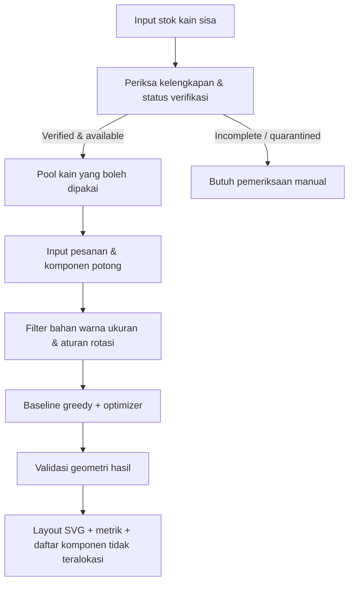

# PRD — LoopCut AI

**Nama produk:** LoopCut AI — Verified Textile Remnant-to-Order Optimizer  
**Versi:** MVP 1.0 / JOINTS Hackathon 2026  
**Status:** Siap dijadikan acuan implementasi; **bukan** laporan hasil eksperimen  
**Tanggal perencanaan:** 13 Oktober 2026  
**Kategori:** Sustainability — limbah pakaian/produksi garmen  
**Target pengumpulan:** 16 Oktober 2026, 23.59 WIB  
**Dokumen terkait:** [`prd-frontend.md`](./prd-frontend.md), [`prd-backend.md`](./prd-backend.md), [`prd-optimization.md`](./prd-optimization.md)

---

## 1. Executive summary

**LoopCut AI** adalah aplikasi web untuk operator konveksi dan usaha garmen skala kecil/menengah yang ingin memanfaatkan potongan kain sisa produksi (remnant/offcut) pada pesanan baru. Aplikasi menggabungkan dua kemampuan:

1. **CircularLot Lite / Material Qualification:** mendokumentasikan identitas dan ukuran kain, lalu memisahkan kain yang *terverifikasi* dari yang informasinya belum lengkap.
2. **OffcutMatch / Cutting Optimization:** menyaring kain yang kompatibel dengan permintaan produk baru, menyusun komponen berbentuk persegi panjang tanpa tumpang tindih, dan membandingkan hasil dengan baseline sederhana.

**Nilai produk:** mengubah stok sisa kain yang tidak terstruktur menjadi **pilihan pemanfaatan dengan layout dan ukuran dampak yang dapat diverifikasi**. Fokus pada *reuse* untuk kebutuhan produksi riil, bukan membuat produk baru yang tidak memiliki permintaan.

**Pernyataan yang harus selalu dipertahankan:** hasil MVP berupa **rencana pemotongan berbasis model**, bukan jaminan penghematan kain/pembelian bahan pada pabrik nyata, bukan pemeriksaan kualitas fisik otomatis, dan bukan bukti pengurangan emisi aktual.

## 2. Permasalahan dan dasar bukti

- **Masalah hulu:** industri garmen menghasilkan sisa pemotongan, ujung gulungan, dan kelebihan material; bagian yang masih berguna sering sulit dicocokkan kembali dengan spesifikasi pesanan baru.
- **Masalah data:** jenis bahan, warna, ukuran, status kerusakan, dan sumber informasi kain sisa bisa tersebar di catatan produksi, sehingga kualitas informasi harus diperiksa sebelum rekomendasi.
- **Masalah keputusan:** menemukan kombinasi penempatan komponen pesanan pada beberapa lembar kain tersisa merupakan persoalan optimasi kombinatorial; strategi mengambil kain pertama yang muat belum tentu memberikan alokasi terbaik.

### Angka dari penelitian, bukan performa LoopCut

| Bukti | Angka yang dilaporkan | Batas interpretasi |
|---|---:|---|
| Aus dkk. (2021), studi kasus dua produsen garmen | Material tersisa 24,7% pada pabrik besar dan 39,2% pada pabrik kecil | Bukan rerata nasional; definisi dan konteks sesuai studi |
| Aus dkk. (2021), kehilangan material dari proses *marker* | 12% pada pabrik besar, 21% pada pabrik kecil | Tidak berarti LoopCut dapat menghilangkan kehilangan tersebut |
| Nurkomariyah dkk. (2026), studi aliran limbah polyester pascaindustri Indonesia | Estimasi 572.000 ton untuk 2023 dan sekitar 61% berupa campuran serat | Konteks masalah Indonesia; tidak sama dengan inventaris stok kain persegi panjang yang akan kita modelkan |

Referensi: [Aus dkk. (2021)](https://doi.org/10.1186/s40691-021-00262-9), [Nurkomariyah dkk. (2026)](https://doi.org/10.3390/recycling11030062). Angka dan batasan harus tetap ditampilkan secara jujur dalam pitch.

## 3. Problem statement

> Bagaimana konveksi yang mempunyai stok kain sisa dengan informasi kualitas beragam dapat mengetahui **mana yang benar-benar boleh dipakai** untuk sebuah pesanan baru dan memperoleh **rencana pemotongan valid** yang memaksimalkan pemanfaatan stok sisa tersebut?

**Bukan problem statement MVP:** mengenali jenis serat secara akurat melalui foto, mengendalikan mesin potong, mengoptimalkan seluruh proses manufaktur, atau otomatis menyelesaikan proses daur ulang tekstil.

## 4. Persona dan pekerjaan pengguna

| Persona | Tujuan (job-to-be-done) | Hambatan saat ini | Indikator berhasil |
|---|---|---|---|
| Operator gudang kain | Mendaftarkan kain sisa dan memeriksa informasi material | Stok tidak seragam, ukuran/komposisi tidak lengkap | Stok dapat difilter dan status verifikasi jelas |
| Admin produksi/penjahit | Memenuhi komponen pesanan dari stok yang sudah ada | Sulit mencari lembar kain yang cocok dan menempatkan pola | Ada layout yang valid dan daftar komponen belum terpenuhi |
| Pemilik konveksi/ketua tim | Menilai potensi pengurangan kebutuhan kain baru | Tidak ada pembanding terukur | Laporan perencanaan dapat dijelaskan dan diekspor |

**Pengguna MVP:** satu operator dalam satu workspace demo; belum membangun fitur multi-tenant, persetujuan banyak pihak, atau sinkronisasi ERP.

## 5. Solusi dan proposisi nilai

### Alur utama (end-to-end)

### Dua kapabilitas terintegrasi

**A. CircularLot Lite — qualification**
- Catat: kode lot, jenis bahan, warna, dimensi dalam mm, catatan kondisi, sumber informasi.
- Status material: `VERIFIED` atau `NEEDS_REVIEW`.
- Status stok: `AVAILABLE`, `QUARANTINED`, `ARCHIVED`.
- Otomatis sertakan **hanya** material `VERIFIED` + `AVAILABLE` yang lolos kompatibilitas.
- Data yang tidak lengkap tidak boleh dipakai untuk alokasi; tampilkan alasan dan langkah perbaikan.
- **Jev / LLM opsional:** mengubah catatan produksi menjadi usulan field terstruktur; hasilnya tetap menunggu verifikasi operator.

**B. OffcutMatch — optimization**
- Masukkan pesanan nyata atau contoh pesanan demo berupa komponen persegi panjang dengan jumlah, bahan, warna, dan izin rotasi 90°.
- Filter stok yang kompatibel, jalankan baseline **first-fit decreasing** (greedy) dan optimizer.
- Hasilkan koordinat pemotongan dan visualisasi untuk setiap lembar sisa.
- Laporkan luas komponen yang dialokasikan dari kain sisa, jumlah komponen terpenuhi, dan komponen belum dialokasikan.
- Gunakan hasil baseline sebagai fallback jika optimizer tidak menghasilkan solusi layak dalam batas waktu.

## 6. Keputusan produk yang dikunci untuk MVP

| Aspek | Keputusan |
|---|---|
| Dimensi | Seluruh ukuran memakai **mm integer**; luas laporan memakai m² (`mm² / 1.000.000`) |
| Material | Kategori terkontrol, misalnya `COTTON`, `POLYESTER`, `DENIM`, `OTHER_SPECIFIED`; **harus cocok persis** dengan persyaratan order |
| Warna | Kode warna yang dinormalisasi; pencocokan **persis**; tidak ada color similarity otomatis |
| Jenis stok | Satu record = satu lembar kain persegi panjang; jumlah identik diimpor menjadi record individual |
| Geometri | Hanya rectangle dengan sisi sejajar sumbu; tidak ada polygon, lubang, atau marker baju kompleks |
| Kondisi | Operator menandai lembar kain layak / harus ditinjau; kerusakan lokal tidak dimodelkan |
| Potongan order | Ukuran yang dimasukkan adalah **ukuran potong termasuk allowance yang dibutuhkan** |
| Rotasi | 0°; 90° hanya bila order secara eksplisit mengizinkan |
| Clearance/kerf | Tidak dimodelkan secara terpisah dalam MVP; pengguna bertanggung jawab memasukkan ukuran potong yang sesuai |
| Inventaris | Hanya **perencanaan**; menjalankan plan tidak otomatis mengurangi stok atau memesan kain |
| Klaim penghematan | `reuse_area_m2` dan `unallocated_area_m2` adalah **proksi luasan komponen**, bukan m² kain baru yang pasti tidak perlu dibeli |
| Kecerdasan inti | Optimasi matematis, bukan ML yang dilatih dari nol |
| LLM / TypeSafe Jev | **P2, non-blocking**, aplikasi harus berfungsi penuh tanpa kredensial AI |

## 7. Scope & prioritas fitur

| ID | Fitur | Prioritas | Kriteria selesai |
|---|---|---|---|
| P-01 | CRUD stok lembar kain | **P0** | Simpan, tampilkan, ubah, filter, arsipkan |
| P-02 | Qualification Gate | **P0** | Stok tanpa material/warna/dimensi valid tidak masuk optimasi |
| P-03 | CRUD pesanan dan komponen | **P0** | Simpan order dengan `quantity`, ukuran, material, warna, rotasi |
| P-04 | Matching material & geometri | **P0** | Menolak pasangan bahan/warna/ukuran yang tidak kompatibel |
| P-05 | Baseline greedy | **P0** | Rencana baseline deterministik dapat dihitung |
| P-06 | Optimization engine | **P0** | Rencana valid, ada batas runtime, status solver jelas |
| P-07 | Visualisasi layout | **P0** | SVG akurat per remnant dengan koordinat terukur |
| P-08 | Perbandingan & laporan | **P0** | Luas reuse, cakupan order, hasil baseline vs hasil terpilih |
| P-09 | Demo seed & uji | **P0** | Skenario normal, mismatch, overflow, timeout, rotasi |
| P-10 | Import CSV | **P1** | Template dan tampilan preview error baris |
| P-11 | Ekspor laporan JSON/CSV/SVG | **P1** | Hasil bisa diunduh dan direproduksi |
| P-12 | LLM/Jev extraction | **P2** | Demo opsional dengan review manusia, tidak memblokir P0 |
| P-13 | Foto kain & computer vision | **OUT** | Tidak dibangun |
| P-14 | Pola garmen bebas/CAD/laser cutter | **OUT** | Tidak dibangun |
| P-15 | Otomatisasi pembelian dan reservasi stok | **OUT** | Tidak dibangun |

**Urutan prioritas pengembangan:** P0 harus selesai sebelum memulai P1, dan P2 hanya dikerjakan jika P0 sudah diuji.

## 8. User stories dan acceptance criteria

### US-01 — Memasukkan material secara aman

> Sebagai operator, saya ingin menyimpan dan memverifikasi sisa kain agar optimizer hanya memakai stok dengan informasi yang bisa dipercaya.

**Given** stok belum punya warna atau bahan terverifikasi, **when** operator menjalankan optimasi, **then** stok tidak dipilih dan alasan pengecualian muncul.

### US-02 — Membuat pesanan produksi

> Sebagai admin produksi, saya ingin membuat daftar komponen potong dengan jumlah dan spesifikasi agar optimizer memahami kebutuhan nyata.

**Given** satu baris komponen berjumlah 3, **when** pesanan diproses, **then** mesin membuat 3 identitas komponen unik dan tiap unit ditempatkan maksimal satu kali.

### US-03 — Mendapat layout valid

> Sebagai penjahit, saya ingin melihat koordinat dan rotasi komponen pada lembar sisa agar rencananya bisa diperiksa.

**Given** hasil solver, **when** validasi geometri berjalan, **then** setiap kotak berada di dalam kain, tidak beririsan, sesuai bahan/warna, dan memenuhi aturan rotasi.

### US-04 — Memahami dampak dan kekurangan

> Sebagai pemilik konveksi, saya ingin membandingkan hasil terhadap baseline agar tidak bergantung pada klaim AI.

**Given** satu run, **when** hasil muncul, **then** dashboard memperlihatkan baseline, solusi yang dipilih, status optimalitas, runtime, dan item yang belum teralokasi.

### US-05 — Tidak tertipu klaim optimasi

> Sebagai pengguna, saya ingin aplikasi membedakan solusi optimal, solusi layak yang belum terbukti optimal, dan fallback.

**Given** solver timeout, **when** baseline tersedia, **then** aplikasi menampilkan baseline atau solusi layak terbaik, memberi label sesuai status sebenarnya, dan tidak menyebutnya optimal.

## 9. Success metrics & cara pengukuran

### Metrik teknis P0

| Metrik | Definisi | Target internal MVP (bukan hasil eksperimen) |
|---|---|---|
| Valid layout rate | Persentase layout output yang lolos validator independen | **100%** untuk hasil yang ditampilkan valid |
| Material mismatch | Komponen ditempatkan pada kain yang salah jenis/warna | **0 kasus** |
| Duplicate placement | Satu unit pesanan dialokasikan >1 kali | **0 kasus** |
| `reuse_area_m2` | Jumlah area fisik komponen yang ditempatkan di kain sisa | Dilaporkan per run |
| `area_coverage_pct` | `100 * reuse_area / total_order_piece_area` | Dilaporkan per run |
| `count_coverage_pct` | `100 * allocated_pieces / total_order_pieces` | Dilaporkan per run |
| `gain_vs_greedy_m2` | `selected_reuse_area - greedy_reuse_area` | Dilaporkan, boleh **0** |
| `solver_status` | `OPTIMAL`, `FEASIBLE_TIMEOUT`, `BASELINE_FALLBACK` dll. | Selalu tersedia |
| Runtime solver | Durasi pemecahan per run | Batas 8 detik untuk ukuran input MVP |

### Desain pengujian

- Minimum 30 skenario **sintetis dan berseed** untuk regression test; **tidak** diklaim sebagai sampel pabrik riil.
- Skenario: material cocok/tidak cocok, status unverified, warna beda, ukuran tidak muat, rotasi 90°, layout padat, banyak stok, timeout.
- Jalankan baseline dan optimizer **pada input dan batasan yang sama**.
- Laporkan jumlah kasus optimizer unggul, seri, dan kalah; jika solver tak selesai, beri label dan pisahkan dari hasil optimal.
- **Jangan menetapkan target “penghematan ≥ X%” sebelum benchmark dijalankan.**

## 10. Indikator pengalaman pengguna

- Demo end-to-end selesai dalam ≤2 menit: stok contoh → pesanan → jalankan plan → bandingkan → lihat layout.
- Pesan error spesifik per field, tidak ada state kosong yang membingungkan.
- Layout tidak terdistorsi dan tidak ada tumpang tindih antara SVG yang ditampilkan dengan koordinat API.
- Halaman responsif untuk laptop presentasi dan smartphone; editor ukuran tetap bisa dipakai di laptop.

## 11. Non-goals, risiko, dan mitigasi

| Risiko | Konsekuensi | Mitigasi MVP |
|---|---|---|
| Scope creep: CV/ML + Jev + solver + marketplace | Prototype tidak selesai | P0 tanpa ketergantungan AI eksternal; fitur P2 dibekukan |
| Data ukuran salah/tidak dipercaya | Layout tidak bisa diterapkan | Verifikasi manual dan data provenance |
| Material tampak cocok tetapi arah serat/motif berbeda | Potongan tidak layak produksi | Izin rotasi eksplisit; tampilkan peringatan keterbatasan |
| Solver lambat/tidak optimal | Demo macet | Timeout, fallback greedy, hasil solver diberi status benar |
| Benchmark bias | Klaim penghematan tidak kredibel | Skenario seeded, satu definisi objective, laporkan kalah/seri |
| Kain sisa kecil/tidak beraturan | MVP kurang cocok untuk sampah kain nyata tertentu | Sasaran awal: lembar persegi panjang, ujung gulungan, stok berlebih |
| Bahan terlalu beragam | Salah substitusi material | Exact matching; tidak ada konversi kelas kain otomatis |
| Optimizer mengurangi stok dalam demo berulang | Status stok tidak konsisten | Run hanya simulasi, tanpa stok konsumsi |

## 12. Roadmap eksekusi empat hari

| Hari | Fokus | Deliverable wajib |
|---|---|---|
| **13 Okt** | Model data, input stok/order, baseline, optimizer awal | API minimal + satu layout valid |
| **14 Okt** | Validasi material, CP-SAT/solver, kasus tepi | P0 matching + solver + validator + tests |
| **15 Okt** | Integrasi Next.js, halaman stok/order/layout, benchmark | Demo end-to-end + angka benchmark dari run nyata |
| **16 Okt** | Bug fix, README, pitch deck, video, publikasi demo | GitHub repo, prototype interaktif, pitch deck PDF, video ≤2 menit |

**Feature freeze:** 15 Oktober malam. Tanggal 16 hanya untuk penyelesaian, verifikasi, dan submission.

## 13. Kebutuhan kompetisi (bersumber dari Guidebook JOINTS 2026)

Guidebook halaman 6, 11, 13 (file `GUIDEBOOK HACKATHON.pdf`):

- **Deadline:** 16 Oktober 2026, pukul 23.59 WIB.
- **Wajib:** source code di GitHub, pitch deck PDF, prototype/mockup, video publik maksimal 2 menit yang diunggah melalui YouTube.
- **Opsional:** proposal PDF maksimal 10 halaman.
- **Bobot penilaian:** inovasi 25%; implementasi teknis 30%; fungsionalitas & desain 20%; dampak & kelayakan 15%; presentasi & demonstrasi 10%.

**Implikasi produk:** kemenangan teknis tidak hanya bergantung pada algoritma; fungsi bekerja, desain jelas, pembuktian dampak, dan demo yang singkat sama pentingnya.

## 14. Definisi Done (DoD) untuk submission

- [ ] Skenario seed bisa disiapkan satu perintah.
- [ ] Stok unverified tidak pernah otomatis lolos material gate.
- [ ] Order dapat dibuat dengan 1–30 potong dan 1–15 stok kain.
- [ ] Greedy dan optimizer menghasilkan output pada kontrak JSON yang sama.
- [ ] Semua placement lolos validator geometri independen.
- [ ] Hasil mencantumkan status solve, waktu, dan unallocated pieces.
- [ ] Frontend menampilkan SVG sesuai koordinat backend.
- [ ] Benchmark minimal 30 skenario berjalan dan tersimpan ke CSV/JSON.
- [ ] README menjelaskan menjalankan app, batasan, dan sumber data.
- [ ] Source GitHub, pitch deck, prototype, dan video memenuhi guidebook.

## 15. Terminologi singkat

- **Remnant/offcut:** kain sisa produksi yang masih mungkin digunakan.
- **Material qualification:** pengecekan kelengkapan dan kesesuaian data material sebelum pemakaian.
- **Nesting:** menyusun komponen pada bidang material tanpa bertabrakan.
- **Optimizer:** algoritma mencari kombinasi penempatan terbaik menurut tujuan dan batasan.
- **Greedy:** algoritma sederhana yang membuat pilihan lokal satu demi satu; dipakai sebagai baseline.
- **Baseline:** metode pembanding yang dijalankan pada input dan aturan identik.
- **CP-SAT:** solver constraint programming dengan teknik SAT untuk masalah kombinatorial.
- **Jev:** model TypeSafe untuk penilaian/keputusan terstruktur; **opsional** pada MVP.
- **MVP:** versi produk paling kecil yang bisa menyelesaikan alur utama.

## 16. Sumber & transparansi

- Guidebook JOINTS 2026, file yang disediakan panitia; halaman 6, 11, 13.
- Aus dkk. (2021): https://doi.org/10.1186/s40691-021-00262-9
- Nurkomariyah dkk. (2026): https://doi.org/10.3390/recycling11030062
- Google OR-Tools CP-SAT documentation: https://developers.google.com/optimization/cp/cp_solver
- TypeSafe documentation (opsional): https://docs.typesafe.ai/introduction

> **Batas validitas:** angka literatur adalah motivasi, bukan hasil MVP. Data order dan inventaris untuk demo serta stress test diberi label **sintetis** hingga tersedia data lapangan yang sah.
